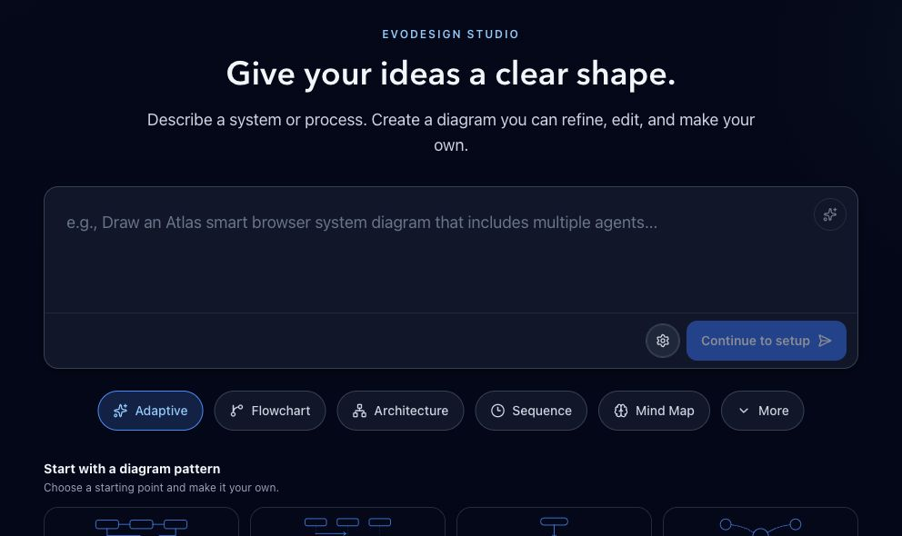

<div align="center">

# EvoDesign

### Turn ideas into diagrams you can keep editing.

**[Get started](#run-locally) · [Website](https://tianfu.wang/EvoDesign/) · [中文入门](docs/quickstart-zh.md) · [Paper](https://arxiv.org/abs/2604.09568)**

Describe it. Refine it. Make it yours.



</div>

EvoDesign is an open-source workspace for creating editable diagrams with AI. Describe an architecture, sequence or process, generate a first draft, then refine and edit it on the canvas. Save your work, reopen it later, and export it when it is ready. Personal design memory helps you carry your preferences into the next diagram.

Run it locally with your own model endpoint. The project builds on our research in agentic diagram creation and evolving design expertise; the [paper](https://arxiv.org/abs/2604.09568) explains the method and evaluation.

## From an idea to a finished diagram

1. **Describe what you need.** Start with your own content or the included quick-start example. Choose whether to include icons.
2. **Review and refine.** Automatic checks and visual feedback guide focused improvements to the draft.
3. **Make the final edits.** Move and restyle canvas elements, or ask for a local change. The result stays editable.
4. **Save, export and reuse.** Reopen projects and manage reusable style, structure and layout preferences in Your DNA.

## What is included

| Component | What you can do |
| --- | --- |
| **Diagram engine** | Generate architecture, sequence, flow and other diagram types; evaluate and refine their design |
| **Web workspace** | Generate, edit, save, reopen and export diagrams; turn icons on or off |
| **Personal design memory** | Manage structure, style and layout preferences; learn from edits; import and export portable rules |
| **Design expertise** | Retrieve reusable strategies from 126 bundled seed entries and evolve knowledge through feedback |
| **Research tooling** | Run baseline adapters, ablations and evaluation with your own data |

Excalidraw is the default canvas. TLDraw remains an optional adapter. Icons are optional and the default curated catalog is bundled. The Python import path `evo_diagram` is retained for compatibility; the project and algorithm are **EvoDesign**.

## Run locally

Requires **Python 3.11+**, **Node.js 22.12+** and a vision-capable model endpoint. Model calls use your own provider account. These instructions install from source; there is no hosted generation API included.

```sh
git clone https://github.com/GeminiLight/EvoDesign.git
cd EvoDesign
python3 -m venv .venv
source .venv/bin/activate
python -m pip install -e ".[backend,test]"
npm ci --prefix frontend
npm ci --prefix evo_diagram/agentic_system/tool_services
python scripts/setup_local.py
```

Fill **`LLM_MODEL_NAME`**, **`LLM_ENDPOINT_URL`** and **`LLM_API_KEY`** in the generated root `.env`, then:

```sh
./scripts/start_service.sh
```

Open **http://localhost:5175**. The API is on port 3010 and rendering service on 3000. Stop with `./scripts/stop_service.sh`. The local setup creates unique secrets and matching guest configuration. Existing `.env` files are never overwritten. See [configuration](docs/configuration.md) for provider selection, optional features and hosted deployment boundaries.

The renderer needs Playwright Chromium for image export. On a machine without it, run `cd evo_diagram/agentic_system/tool_services && npx playwright install chromium`. Linux may need `npx playwright install --with-deps chromium` and native Canvas libraries (`libcairo2-dev`, `libpango1.0-dev`, `libjpeg-dev`, `libgif-dev`, `librsvg2-dev`, `pkg-config`). The first design-memory run may download its embedding model.

### Use the engine without the web UI

With the Python environment, model configuration and renderer running:

```sh
python -m evo_diagram.agentic_system.main --example 1 --dataset-path examples/diagrams/quickstart.json
# Icons are opt-in:
python -m evo_diagram.agentic_system.main --example 1 --dataset-path examples/diagrams/quickstart.json --use-icons
```

Use `--help` for custom input, refinement, ablations and personal edit-learning options. [Reproducibility notes](docs/reproducibility.md) explain model/judge configuration, experiment records and the distinction between this maintained release and the manuscript's reported scores.

## Personal design memory

The complete memory implementation is included: preference extraction, storage, retrieval, scoped DNA rules and web management. Start with the [design-memory guide](docs/design-memory.md) and the [eight-rule blue-violet example](examples/design-memory/blue-violet.json):

```sh
python scripts/design_memory.py validate examples/design-memory/blue-violet.json
```

Signed-in users can export and additively import rules through the same utility. Guest preferences stay in the browser. Private account databases, generated diagrams and live vector stores are not bundled.

## Research behind the product

EvoDesign is based on **Agentic Editable Diagram Creation via Design Expertise Evolution**. Structure, style and layout agents coordinate over an editable canvas representation; verification and refinement provide feedback for reusable design expertise. Read the [paper](https://arxiv.org/abs/2604.09568) for the algorithm and CanvasBench evaluation.

The repository includes the implementation, evaluation tools and baseline adapters. **Training and test datasets will be released separately.** The one-task quick-start example is for trying the software, not benchmarking it. The website's research scores are manuscript-reported results; this maintained code release does not claim a fresh reproduction of the full experiment. See [reproducibility notes](docs/reproducibility.md) for research use.

## Repository map

```text
evo_diagram/          Core agents, refinement, memory and renderer service
backend/              FastAPI, projects, authentication and personal DNA
frontend/             React workspace and editable canvas adapters
configs/              Model roles and application settings
dataset_construction/ Dataset preparation utilities
evaluation/           Evaluation and analysis
baselines/            Comparison methods and adapters
examples/             Quick-start task and portable personal-memory example
scripts/              Setup, services, quality checks and experiments
docs/                 Paper website and public guides
research/             Authoritative paper metadata
```

## Development

Start with the [contribution guide](CONTRIBUTING.md), [quality checks](sop/engineering-quality.md) and [backend API reference](sop/backend-api-surface.md). Contributions in English or Chinese are welcome.

```sh
python -m pip install -e ".[dev]"
./scripts/check_quality.sh all
```

See [contributing](CONTRIBUTING.md), [configuration](docs/configuration.md) and [third-party notices](THIRD_PARTY_NOTICES.md). Please include a minimal input, model identifier, release commit and relevant redacted logs when reporting a bug. Do not attach API keys, account databases or private prompts.

## Citation

If you use EvoDesign or CanvasBench, please cite the paper. GitHub's **Cite this repository** action is backed by `CITATION.cff`.

<!-- CITATION:START -->

```bibtex
@misc{wang2026evodesign,
  title = {{EvoDesign}: Agentic Editable Diagram Creation via Design Expertise Evolution},
  author = {Wang, Tianfu and
            Ding, Leilei and
            Tao, Ziyang and
            Zhan, Yi and
            Ma, Zhiyuan and
            Wu, Wei and
            Lei, Yuxuan and
            Wang, Junyang and
            Wu, Yin and
            Xu, Yizhao and
            Zhu, Hongyuan and
            Liu, Qi and
            Yuan, Nicholas Jing and
            Zhang, Yanyong and
            Xiong, Hui},
  year = {2026},
  eprint = {2604.09568},
  archivePrefix = {arXiv},
  primaryClass = {cs.HC},
  doi = {10.48550/arXiv.2604.09568},
  url = {https://arxiv.org/abs/2604.09568}
}
```

<!-- CITATION:END -->

## License

Original EvoDesign software contributions are released under [MIT](LICENSE). Dependencies, bundled fonts/icons and incorporated third-party material retain their own terms; see [THIRD_PARTY_NOTICES.md](THIRD_PARTY_NOTICES.md). In particular, the optional TLDraw SDK uses its upstream license. The software license does not relicense the paper or third-party dataset source material.
