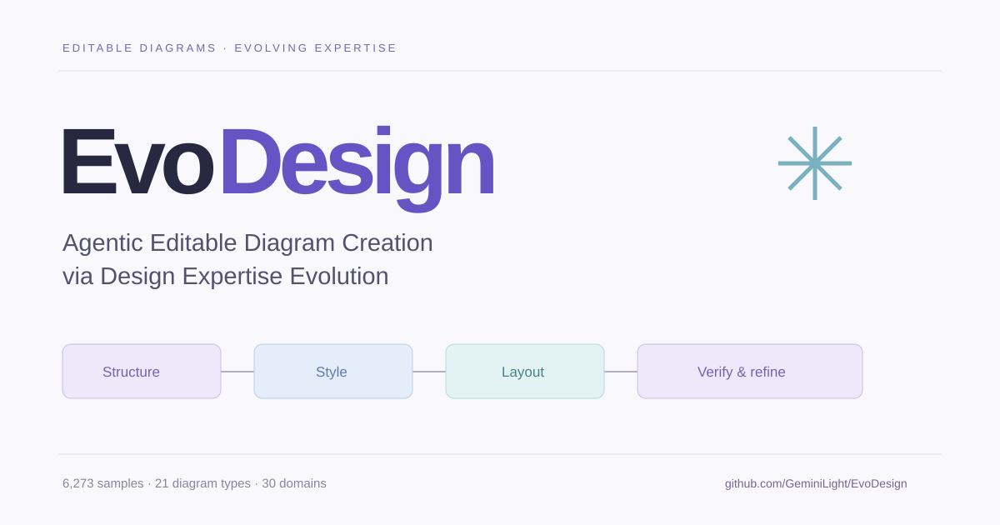

<div align="center">



**[Project page](https://tianfuwang.tech/EvoDesign/)** · **[Cite](https://tianfuwang.tech/EvoDesign/#citation)** · **Code coming soon** · **[Paper (arXiv)](https://arxiv.org/abs/2604.09568)**

<sub>Tianfu Wang¹ · Leilei Ding² · Ziyang Tao² · Yi Zhan² · Zhiyuan Ma² · Wei Wu² · Yuxuan Lei² · Junyang Wang² · Yin Wu¹ · Yizhao Xu³ · Hongyuan Zhu² · Qi Liu² · Nicholas Jing Yuan¹ · Yanyong Zhang² · Hui Xiong¹˒⁴</sub>

<sub>¹ The Hong Kong University of Science and Technology (Guangzhou)<br>² University of Science and Technology of China · ³ Peking University<br>⁴ The Hong Kong University of Science and Technology</sub>

</div>

## Overview

EvoDesign is an agentic framework for editable diagram generation that coordinates structure, style, and layout agents and evolves reusable design expertise. It represents a diagram as a machine-actionable, human-editable canvas manifest, connecting generation, diagnostic verification, localized refinement, and reusable design knowledge.

- **Create:** structure, style, and layout agents coordinate semantic topology, visual encoding, and spatial arrangement.
- **Verify:** objective checks and VLM critique identify visual-spatial defects and guide local repairs.
- **Evolve:** verified refinement traces become sample strategies, domain guidelines, and general principles, with evidence preserved through promotion and maintenance.

The project, paper, and algorithm are named **EvoDesign**. **CanvasBench** is the associated benchmark.

## Release status

This repository currently hosts the project website. The research implementation will be added here in a future release.

| Resource | Status |
| --- | --- |
| Project website | [Available](https://tianfuwang.tech/EvoDesign/) |
| Research implementation | Coming soon |
| Research paper | [arXiv:2604.09568](https://arxiv.org/abs/2604.09568) |
| CanvasBench release details | Forthcoming |

The interactive canvas on the website is a browser-local illustration of editability, not a live deployment of the research system. No installation commands, model checkpoints, or dataset downloads are claimed at this stage.

## CanvasBench

CanvasBench contains **6,273 validated samples** across **21 diagram types** and **30 content domains**. The training/evolution split has 5,853 samples, and the balanced held-out test split has 420 samples (20 per diagram type).

Evaluation covers ten metrics across three dimensions:

| Dimension | Metrics |
| --- | --- |
| Content integrity | Content fidelity, concept logic, semantic relevance |
| Visual presentation | Visual aesthetics, styling consistency, flow coherence, space balance |
| Cognitive utility | Cognitive ease, comprehension accuracy, self-contained explanation |

## Reported results

The table below summarizes manuscript Table 1 for the GPT-5.5 backbone. Each value is the arithmetic mean of the metrics within that dimension, on a 1–5 scale. Results are reported by the manuscript, not independently reproduced here. The website includes all four reported backbone settings.

| Method | Content | Visual | Cognitive |
| --- | ---: | ---: | ---: |
| GPT-4o-Image (pixel baseline) | 2.301 | 3.667 | 3.080 |
| LaTeX TikZ | 3.468 | 2.856 | 3.199 |
| DiagramAgent | 2.132 | 2.707 | 2.450 |
| SciSketch | 3.810 | 2.952 | 3.307 |
| Schema prompting | 3.687 | 2.482 | 2.752 |
| **EvoDesign** | **4.099** | **3.659** | **3.503** |

Under GPT-5.5, EvoDesign improves over one-shot schema prompting by **+1.472** on space balance and **+1.106** on cognitive ease. These are differences in individual metric scores. [Download all reported metrics as CSV](docs/results.csv).

## Website development

The website is static HTML, CSS, and JavaScript in [`docs/`](docs/). It has no build step or runtime dependencies.

```sh
python3 -m http.server 8000 --directory docs
```

Open `http://localhost:8000`. See [website maintenance](WEBSITE.md) for author, paper, results, and deployment updates.

## Citation

[Copy the citation](https://tianfuwang.tech/EvoDesign/#citation) or download [BibTeX](docs/citation.bib) / [RIS](docs/citation.ris).

<!-- CITATION:START -->

```bibtex
@misc{wang2026evodesign,
  title = {{EvoDesign}: Agentic Editable Diagram Creation via Design Expertise Evolution},
  author = {Wang, Tianfu and
            Ding, Leilei and
            Tao, Ziyang and
            Zhan, Yi and
            Ma, Zhiyuan and
            Wu, Wei and
            Lei, Yuxuan and
            Wang, Junyang and
            Wu, Yin and
            Xu, Yizhao and
            Zhu, Hongyuan and
            Liu, Qi and
            Yuan, Nicholas Jing and
            Zhang, Yanyong and
            Xiong, Hui},
  year = {2026},
  eprint = {2604.09568},
  archivePrefix = {arXiv},
  primaryClass = {cs.HC},
  doi = {10.48550/arXiv.2604.09568},
  url = {https://arxiv.org/abs/2604.09568}
}
```

<!-- CITATION:END -->

## Contact

The paper is available at [arXiv:2604.09568](https://arxiv.org/abs/2604.09568). For research inquiries, contact [Hui Xiong](mailto:xionghui@ust.hk).
