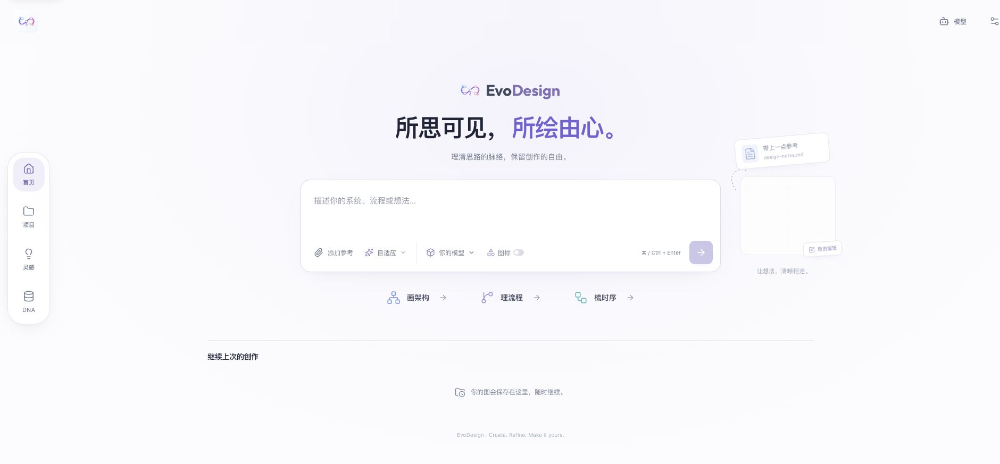
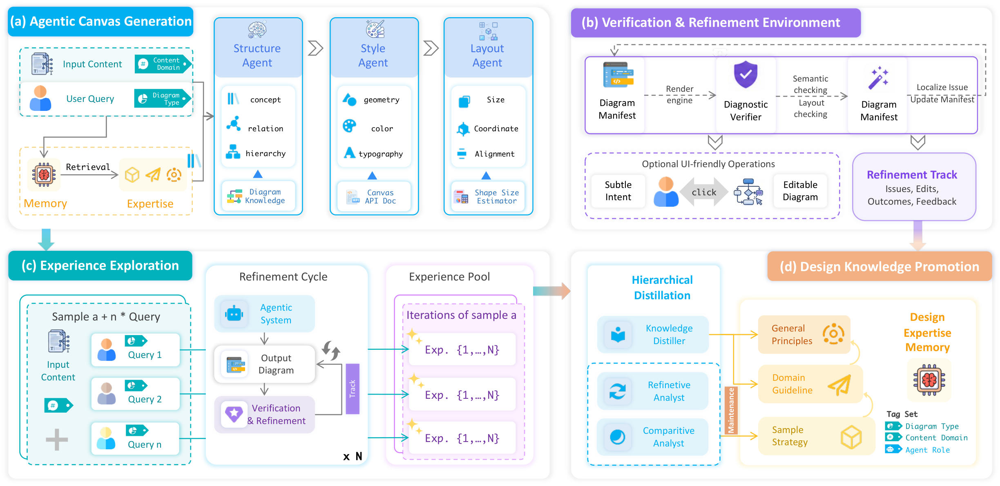

<div align="center">

<picture>
  <source media="(prefers-color-scheme: dark)" srcset="frontend/public/evodiagram-dark.svg">
  <source media="(prefers-color-scheme: light)" srcset="frontend/public/evodiagram.svg">
  
</picture>

# EvoDesign

### 把想法变成可以继续编辑的图。

[English](README.md) · **简体中文**

<!-- PROJECT-LINKS:START -->
<div align="center">

[](https://evodesign.vercel.app/)
[](https://tianfu.wang/EvoDesign/)
[](https://arxiv.org/abs/2604.09568)

</div>
<!-- PROJECT-LINKS:END -->

[中文入门](docs/quickstart-zh.md) · [浏览器版使用说明（英文）](docs/browser-edition.md)



<sub>当前浏览器版界面：输入想法，添加参考资料，选择图表类型和模型，即可开始创作。</sub>

</div>

EvoDesign 是一个用 AI 创建可编辑图表的开源工作台。描述你要表达的架构、交互或流程，生成初稿，再在画布上继续调整。作品可以保存、重新打开和导出；个人设计记忆帮助你在下一张图中沿用自己的偏好。

可以直接[在线体验](https://evodesign.vercel.app/)共享的 GLM-5.3-Flash 演示服务或接入自己的模型，也可以在本地运行完整版。项目源于我们关于多智能体图表生成与设计经验进化的研究，方法和评估见[论文](https://arxiv.org/abs/2604.09568)。

[在线体验](#在线体验) · [本地运行](#本地运行) · [工作原理](#工作原理) · [目录结构](#目录结构)

## 从想法到一张图

1. **描述需求。** 输入自己的内容，或使用仓库附带的快速示例；按需开启图标。
2. **检查并改进。** 自动检查与视觉反馈帮助定位问题，对初稿进行针对性调整。
3. **完成最后的编辑。** 移动元素、修改样式，或用自然语言提出局部修改。结果始终可以继续编辑。
4. **保存、导出与复用。** 重新打开已有作品，在 DNA 中管理可复用的结构、风格与布局偏好。

## 项目包含什么

| 模块 | 可以做什么 |
| --- | --- |
| **图表引擎** | 生成架构图、时序图、流程图等图表，评估并改进图表设计 |
| **网页工作台** | 生成、编辑、保存、重新打开和导出图表，按需开启或关闭图标 |
| **个人设计记忆** | 管理结构、风格与布局偏好，从编辑中学习，导入和导出可迁移的规则 |
| **设计经验库** | 检索 126 条内置种子经验，并通过反馈积累和演化知识 |
| **研究工具** | 使用自己的数据运行基线方法、消融实验和评估 |

默认画布为 Excalidraw，TLDraw 保留为可选适配器。图标可选，默认精选图标目录已随代码提供。项目和算法统一命名为 **EvoDesign**；Python 包名保留为 `evo_diagram`，以兼容已有调用。

## 在线体验

打开 **[EvoDesign Studio](https://evodesign.vercel.app/)** 即可使用共享的 **GLM-5.3-Flash** 演示服务，无需 API Key。在**模型设置**中，也可以填写自己的 API 地址、模型 ID 和密钥。自定义服务商需要允许浏览器跨域请求（CORS）。项目保存在当前浏览器中，建议导出副本作为备份。

浏览器版无需运行 Python 后端，即可生成可编辑图表、选择图标、检查内容、局部编辑、保存和导出。共享演示请求由 Vercel 函数转发到智谱 BigModel，服务密钥保留在服务端，共享用量设有上限。使用自己的模型时，请求直接发送到你配置的服务商。

| | 浏览器版 | 完整本地版 |
| --- | --- | --- |
| **开始使用** | 打开演示页面，无需 API Key 或 EvoDesign 账户 | 安装 Python 和 Node.js，配置自己的模型 |
| **生成与检查** | 生成图结构，在本地计算布局，可选内容检查 | 结构、样式与布局智能体，验证和可选视觉修复 |
| **设计记忆** | 在本地管理偏好，并将其加入后续提示词 | 个人记忆、设计经验检索与知识进化 |
| **项目存储** | 当前浏览器；可导出副本备份 | 你运行的后端和数据库 |

在线版适合直接体验可编辑生成；下文的方法图介绍完整的研究框架。两版的能力与数据处理方式详见[能力和隐私说明（英文）](docs/browser-edition.md)。

## 工作原理

EvoDesign 围绕一份 **diagram manifest（图表清单）** 组织生成和反馈。它是一种由可编辑对象组成的画布表示：智能体可以更新它，用户也能直接在画布上修改。



*方法图直接导出自当前维护的论文稿件。[查看高清原图](docs/assets/method-overview.png) · [阅读论文](https://arxiv.org/abs/2604.09568)。*

1. **生成可编辑图表。** 结构、样式和布局智能体将原文与用户要求转换为画布清单，并参考检索到的设计经验。
2. **验证并局部修复。** 渲染图表，检查几何缺陷与视觉质量，应用局部编辑后再次验证。
3. **积累有依据的经验。** 保存修复轨迹中的问题、编辑和结果，为候选设计策略保留证据。
4. **演化可复用的知识。** 将获得支持的策略提炼为适用范围更广的准则与原则，维护经验库，并在未来的绘图任务中检索使用。

## 本地运行

需要 **Python 3.11+**、**Node.js 22.12+**，以及支持视觉输入的模型服务。模型调用使用你自己的服务商账户。以下步骤从源码安装，不包含托管的生成 API。

```sh
git clone https://github.com/GeminiLight/EvoDesign.git
cd EvoDesign
python3 -m venv .venv
source .venv/bin/activate
python -m pip install -e ".[backend,test]"
npm ci --prefix frontend
npm ci --prefix evo_diagram/agentic_system/tool_services
python scripts/setup_local.py
```

在生成的根目录 `.env` 中填写 **`LLM_MODEL_NAME`**、**`LLM_ENDPOINT_URL`** 和 **`LLM_API_KEY`**，然后启动：

```sh
./scripts/start_service.sh
```

打开 **http://localhost:5175**。API 服务运行在 3010 端口，渲染服务运行在 3000 端口。使用 `./scripts/stop_service.sh` 停止服务。本地初始化会创建独立的密钥及匹配的访客配置，不会覆盖已有 `.env` 文件。服务商选择、可选功能和自行部署的边界见[配置说明（英文）](docs/configuration.md)。

渲染器导出图片需要 Playwright Chromium。若尚未安装，执行 `cd evo_diagram/agentic_system/tool_services && npx playwright install chromium`。Linux 可能还需要 `npx playwright install --with-deps chromium` 和 Canvas 原生依赖（`libcairo2-dev`、`libpango1.0-dev`、`libjpeg-dev`、`libgif-dev`、`librsvg2-dev`、`pkg-config`）。首次使用设计记忆时，可能会下载嵌入模型。

### 不启动网页，直接使用引擎

准备好 Python 环境、模型配置，并启动渲染服务后，运行：

```sh
python -m evo_diagram.agentic_system.main --example 1 --dataset-path examples/diagrams/quickstart.json
# 图标默认关闭，需要时启用：
python -m evo_diagram.agentic_system.main --example 1 --dataset-path examples/diagrams/quickstart.json --use-icons
```

使用 `--help` 查看自定义输入、修复、消融实验和个人编辑学习等选项。[复现说明（英文）](docs/reproducibility.md) 介绍模型与评审模型的配置、实验记录，以及当前维护版本与论文报告结果之间的区别。

## 个人设计记忆

仓库包含完整的记忆实现：偏好提取、存储、检索、带作用域的 DNA 规则和网页管理。可先阅读[设计记忆指南（英文）](docs/design-memory.md)，再用[蓝紫配色的八条示例规则](examples/design-memory/blue-violet.json) 尝试校验：

```sh
python scripts/design_memory.py validate examples/design-memory/blue-violet.json
```

登录用户可以用同一工具导出和增量导入规则。访客偏好保存在浏览器中。代码发布不包含私人账户数据库、生成的图表或实际运行的向量数据库。

## 研究与复现

[论文 **EvoDesign: Agentic Editable Diagram Creation via Design Expertise Evolution**](https://arxiv.org/abs/2604.09568) 介绍了完整方法，并通过 CanvasBench 从内容、视觉和认知三个维度进行评估。

仓库包含实现、评估工具和基线适配器。**训练和测试数据集将单独发布。** 仓库附带的单任务快速示例用于试用软件，不用于基准评估。项目网站展示的是论文报告的研究结果；当前维护版本不代表已重新复现完整实验。研究使用请参考[复现说明（英文）](docs/reproducibility.md)。

## 目录结构

```text
evo_diagram/          核心智能体、修复、记忆与渲染服务
backend/              FastAPI、项目、认证与个人 DNA
frontend/             React 工作台与可编辑画布适配器
configs/              模型角色与应用设置
dataset_construction/ 数据集准备工具
evaluation/           评估与分析
baselines/            对比方法及适配器
examples/             快速示例与可迁移的个人记忆规则
scripts/              初始化、服务、质量检查与实验脚本
docs/                 论文项目网站与公开使用指南
research/             论文元数据
```

## 参与开发

请先阅读[贡献指南](CONTRIBUTING.md)、[质量检查流程](sop/engineering-quality.md) 和[后端 API 说明](sop/backend-api-surface.md)。欢迎使用中文或英文参与贡献。

```sh
python -m pip install -e ".[dev]"
./scripts/check_quality.sh all
```

更多信息见[贡献指南](CONTRIBUTING.md)、[配置说明](docs/configuration.md) 和[第三方声明](THIRD_PARTY_NOTICES.md)。报告问题时，请附最小输入、模型标识、所用版本的提交号，以及隐去敏感信息的日志。不要附上 API Key、账户数据库或私人提示词。

## 贡献者

EvoDesign 延续了早期 EvoDiagram 项目的工作。我们在此列出早期项目与当前工作台的贡献者。

| 贡献者 | 贡献内容 |
| --- | --- |
| [Tianfu Wang](https://github.com/GeminiLight) | 图表引擎、可编辑 Web 工作台、设计记忆、科研工具与项目维护 |
| [Yi Zhan（占一）](https://github.com/USTChandsomeboy) | 图表生成质量、架构图布局与样式、连线路由和碰撞检测 |

占一的贡献记录保留在早期 EvoDiagram 开发历史中，这里补充其在项目迁移至 EvoDesign 后的贡献署名。完整科研作者名单见[论文](https://arxiv.org/abs/2604.09568)与[引用](#引用)。

## 引用

如果使用了 EvoDesign 或 CanvasBench，请引用论文。GitHub 的 **Cite this repository** 功能读取仓库中的 `CITATION.cff`。

<!-- CITATION:START -->

```bibtex
@misc{wang2026evodesign,
  title = {{EvoDesign}: Agentic Editable Diagram Creation via Design Expertise Evolution},
  author = {Wang, Tianfu and
            Ding, Leilei and
            Tao, Ziyang and
            Zhan, Yi and
            Ma, Zhiyuan and
            Wu, Wei and
            Lei, Yuxuan and
            Wang, Junyang and
            Wu, Yin and
            Xu, Yizhao and
            Zhu, Hongyuan and
            Liu, Qi and
            Yuan, Nicholas Jing and
            Zhang, Yanyong and
            Xiong, Hui},
  year = {2026},
  eprint = {2604.09568},
  archivePrefix = {arXiv},
  primaryClass = {cs.HC},
  doi = {10.48550/arXiv.2604.09568},
  url = {https://arxiv.org/abs/2604.09568}
}
```

<!-- CITATION:END -->

## 许可

EvoDesign 原创软件代码采用 [MIT 许可](LICENSE)。依赖、内置字体和图标，以及引入的第三方材料保留各自条款，详见[第三方声明](THIRD_PARTY_NOTICES.md)。可选的 TLDraw SDK 遵循其上游许可。软件许可不改变论文或第三方数据集来源材料的许可。
