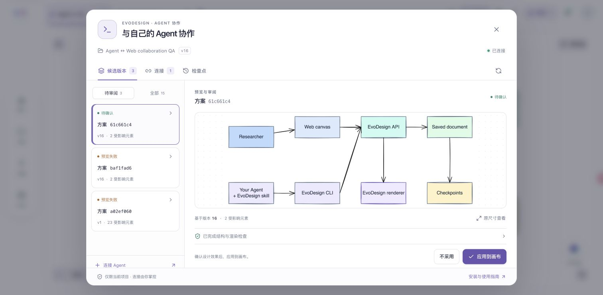

# Design with your existing Agent

[简体中文](agent-collaboration.zh-CN.md) · [Project README](../README.md)

Use your terminal Agent to read your paper, code or notes, prepare an editable diagram, inspect its rendered preview, and continue from changes you make in EvoDesign Web. The bundled skill describes the workflow; the standalone CLI connects it to your project.

This first version supports **Excalidraw projects in the backend edition**. The public browser edition stores projects locally and cannot share those projects with the CLI. MCP and TLDraw editing are deferred.

## Install and connect

Start the full edition using the [local setup](../README.md#run-locally). Backend, frontend and renderer must be available. Configure `FRONTEND_URL` to the Web origin that should approve connections. For a non-default renderer address, also set `EXCALIDRAW_RENDER_URL` to its `/renderers/excalidraw` page.

Install only the CLI in a separate Python 3.11+ environment, from the repository root:

```sh
python3 -m venv .venv-cli
source .venv-cli/bin/activate
python -m pip install ./cli
evodesign --version
evodesign connect --server http://localhost:3010 --profile paper
```

The CLI depends on `httpx` and its dependencies. It does not install or import the diagram engine. The backend and renderer run where your project is stored. Agent edits use deterministic operations, structural checks and PNG rendering; these operations do not call an EvoDesign generation model. The existing Web generation workflow uses its own model configuration.

In Web, sign in, enter the code printed by the CLI, and select an Excalidraw project or create a blank one. **I review and apply** is the default. Choose **Let my Agent apply changes** when the Agent should be able to commit. Each connection grants access to one project and expires after 24 hours. Revoke it in the project's Agent panel or run `evodesign disconnect --profile paper`.

Use `--no-browser` when you want to open the printed approval link yourself. Remote backends require HTTPS; local loopback HTTP is supported. The server origin excludes `/api/v1`.

## Give your Agent the skill

For a runnable first candidate, choose a blank project during approval, then run:

```sh
python examples/agent_cli/quickstart.py --profile paper
```

This creates a two-node candidate and downloads its real PNG. It does not commit, and it refuses a nonempty project. Review and accept it in Web. No model key is needed for this example.

The skill is [skills/evodesign/SKILL.md](../skills/evodesign/SKILL.md), with command and operation references alongside it. Register that directory through your Agent's skill installation method. To try it without changing your Agent configuration, ask:

> Read this repository's `skills/evodesign/SKILL.md` and follow its workflow. Use the connected `paper` profile to turn my material into an editable diagram. Inspect the PNG and keep unrelated manual edits when revising it.

The host needs terminal access to `evodesign`. Image viewing is needed to inspect visual quality. If it cannot view images, it should say so and leave visual review to you. No additional Agent runtime or nested model session is started by the CLI.

## Read, prepare, review, commit

```sh
evodesign document get --profile paper --json
evodesign context get --profile paper --json
# The Agent writes ops.json using the returned version, IDs and constraint hash.
evodesign proposal create --profile paper --file ops.json --operation-id YOUR_UNIQUE_ID --json
evodesign proposal wait PROPOSAL_ID --profile paper --timeout 90 --json
evodesign proposal preview PROPOSAL_ID --profile paper --output preview.png --json
# Inspect preview.png and the returned check report before committing.
evodesign proposal commit PROPOSAL_ID --profile paper --json
```

Replace uppercase values with actual results. The [operation reference](../skills/evodesign/references/operations.md) defines the input. Supported operations are `add_node`, `connect`, `set_text`, `set_style`, `move_node` and `delete_node`. A batch declares project scope or explicit element IDs. Arbitrary native JSON patches and a CLI generation command are not supported.

Creating a candidate does not change the saved document. `ready` means structure validation and PNG rendering succeeded. Read reported layout issues and inspect the real image; the server does not perform a visual model review for these candidates. A failed candidate stays available with its report; prepare a corrected candidate with a new operation ID.

On commit, the server checks the original version and saved constraints, creates a checkpoint and advances the version. Repeating a successful commit returns that result without creating another version. If a response is lost, query the same proposal before repeating a write.

The Web Agent panel lists connections, identifiable candidates, previews and checkpoints. It also accepts candidates when the connection cannot commit. Clean canvases check for external changes about every two seconds while visible; offline checks back off and resume on visibility or network changes.

## Review designs in Web

Open **Agent** in the canvas toolbar. Candidates, connections and checkpoints have separate views. Choose a candidate, inspect its real PNG, and use **View at 100%** for detail. **Apply to canvas** becomes available after the image loads successfully. Continue editing on the canvas afterward. The **All** filter retains failed, expired, conflicted and committed records.



The connection view includes the terminal command, setup steps, permission and expiry. Disconnecting has a cancelable confirmation. Restoring a checkpoint prepares a candidate for the same review process.

## Continue after a Web edit

Save your canvas edit, then let the Agent read the document again. Edits to another node retain the saved manual positions and unaffected elements. Both clients use the same effective saved DNA: project rules take precedence when present; clearing project rules returns to account rules. Unsynced local preferences are not presented as saved Agent constraints.

Select canvas elements and click **Share selection** on the intended connection to make an explicit handoff. This saves first and publishes the selected IDs for ten minutes, tied to the saved version. The Agent includes the returned `context_version` when using that selection. An expired or empty selection does not become a whole-project request. Native locked elements, their labels and locked image data remain protected.

If Web has unsaved edits when an external version arrives, it pauses automatic saving and keeps the local canvas. Open the Agent panel to inspect the saved version's PNG, download your local `.excalidraw` draft, and explicitly choose whether to replace it. Viewing an old checkpoint also keeps that view until you choose a saved version.

If the version or DNA changes after candidate creation, commit returns a conflict and retains the candidate. Re-read and prepare a new candidate that incorporates the new saved work. Never put an old scene under a newer version number.

## Restore and inspect

```sh
evodesign project open --profile paper
evodesign document preview --profile paper --output saved.png --json
evodesign history list --profile paper --json
evodesign history restore SNAPSHOT_ID --profile paper --base-version CURRENT_VERSION --operation-id YOUR_UNIQUE_ID --json
```

Restoration prepares a candidate from a checkpoint. Review and commit it through the same process. It creates a new version; it does not rewind the version counter or modify the old checkpoint. Working snapshots and checkpoints are distinguished by `is_checkpoint`. Autosaving after a checkpoint forks a working snapshot.

## Automation and credentials

Every command accepts `--profile` and `--json`. JSON mode writes one protocol-v1 envelope to stdout and diagnostics to stderr. [CLI reference](../skills/evodesign/references/cli.md) lists all commands and exit codes: 2 input, 3 credentials, 4 permissions/missing project, 5 conflicts, 6 invalid edit, 7 preview failure, 8 network/server/wait timeout.

Profiles and opaque project credentials are stored outside the repository, under `~/.config/evodesign` by default. The directory is private and credential files use mode `0600`. `EVODESIGN_CONFIG_DIR` can select another private location. The CLI never needs a copied Web token. These filesystem permissions are verified on macOS/Linux; Windows credential storage is not validated in v1.

Read [the architecture and implementation contract](../wiki/specs/spec-agent-cli-v1.md) for the shared API, version fences and module boundaries.
