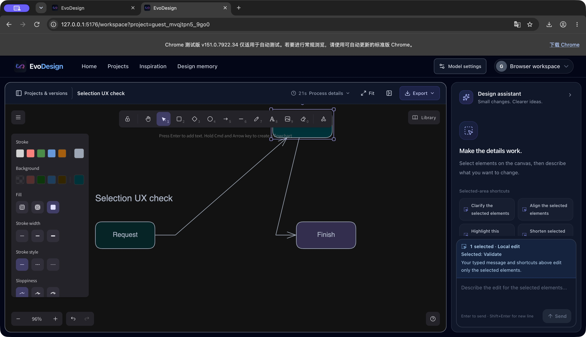

# Browser edition validation — 27 October 2026

Six real-model workflows completed on Vercel previews: architecture, sequence and complex flow diagrams, each with icons disabled and enabled. Each successful case included generation, content review, a selected-object edit, saving, reopening, and editable Excalidraw, SVG and PNG exports. This is a functional validation record, not a model benchmark or a reproduction of the paper's evaluation.

## Results

Times below are the application's rounded generation-plus-review times. Browser layout took less than one second in these cases. They exclude editing, manual inspection and export time, and are single successful observations rather than latency guarantees.

| Diagram | Icons | Nodes / connections | Plan | Review | Total | Connection |
| --- | --- | --- | --- | --- | --- | --- |
| Architecture | Off | 14 / 21 | 14 s | 34 s | 49 s | Pollinations, direct browser |
| Architecture | On | 14 / 21 | 24 s | 29 s | 53 s | Pollinations, direct browser |
| Sequence | Off | 5 / 14 messages | 15 s | 30 s | 45 s | Pollinations, direct browser |
| Sequence | On | 5 / 14 messages | 13 s | 48 s | 61 s | Pollinations, direct browser |
| Complex flow | Off | 18 / 23 | 24 s | 19 s | 43 s | Kimi, temporary local test connection |
| Complex flow | On | 18 / 23 | 39 s | 38 s | 77 s | Kimi, temporary local test connection |

Pollinations used `openai-fast` with low reasoning effort. Kimi used the configured `k3` model with low reasoning effort. These are different providers and workloads; the table does not establish a provider speed ranking or an icon-related latency effect.

The four direct-browser cases ran on preview deployment `dpl_EtH6f5i8FZkyZSBeMmCu3kEqrB5A`; the two Kimi cases ran on `dpl_FuiEqPgfJrCYLBhwy6rws2tXmcee`. A final three-node Kimi generation and review also completed in 21 seconds on the local production build to inspect the selection-label change.

## What was checked

- All six cases completed content review and an actual local label edit. Five also changed the selected node's fill. Sequence icons-off succeeded with a narrower label-only instruction after a combined edit failed.
- Architecture and flow diagrams had no connections crossing the interiors of unrelated node boxes in the exported geometry. The flow retained four decisions, parallel fraud/stock checks, the payment retry loop and stock-release compensation paths.
- Both sequence diagrams retained five participants in order, fourteen chronological messages, five dashed lifelines and a self-message.
- Icon-on cases contained 14, 4 and 14 icons respectively. Embedded icon assets survived local editing, reopening and export. Icons are optional per node; enabling them does not require an icon on every participant.
- Edited and reopened scenes matched in element content, geometry, bindings and embedded assets. Local edits preserved unrelated nodes and connectivity. The flow icon-on case included less than three scene units of endpoint adjustment on three incident arrows after native canvas binding repair.
- All six cases produced valid editable Excalidraw files, SVG XML and PNG files through the workspace export menu.
- A deliberately invalid Kimi model verified that a failed edit shows an error and preserves the typed instruction. Selecting a nearby arrow instead of a node exposed a usability issue; the panel now identifies the selected node or connection before sending.

## Fixes prompted by the run

Connections now detour around unrelated nodes when the initial layout crosses them. Readable model-generated identifiers are normalized without losing their connections. Browser prompts no longer request unsupported placeholder legends. Fit-to-canvas uses the available space more accurately.

Model settings have a scrollable body, visible action buttons, a cancellable connection test and optional reasoning effort. Progress shows the actual browser stages and configured model. Short, explicit provider cooldowns can retry once; cancellation stops the wait. Review failures preserve the initial diagram and retain their reason and elapsed time in the process report. Failed edit instructions remain available for correction.

## Limits and failures observed

The Pollinations anonymous endpoint later returned HTTP 500 for both a flow review and an independent simple request. Its default reasoning also exhausted the small output allowance in an earlier diagnostic. It is a best-effort experimental service, not a dependable production default. Four completed workflows do not establish ongoing availability.

Kimi Coding's tested endpoints did not permit cross-origin browser requests: preflight returned 404 without an allow-origin header. The two Kimi flow tests therefore used a temporary, loopback-only development connection restricted to the test origins and the configured Kimi endpoint. The key stayed in the local process and was never added to Vercel, source files or browser settings. **Those two cases are not evidence that Kimi Coding works directly from the public site.** The production browser edition still requires a provider that allows browser access; no shared proxy or shared model key was deployed.

Browser review is a second model call over the diagram plan. It does not inspect a rendered image, run the Python visual refiner or learn design memories automatically. The full local edition provides the research pipeline.

Local validation also passed 19 browser tests, 8 icon tests and 26 editor tests, ESLint, and both full-mode and browser-mode production builds. The six exported scene comparisons and UI inspection supplement those automated checks; they do not replace broader device and accessibility testing.
