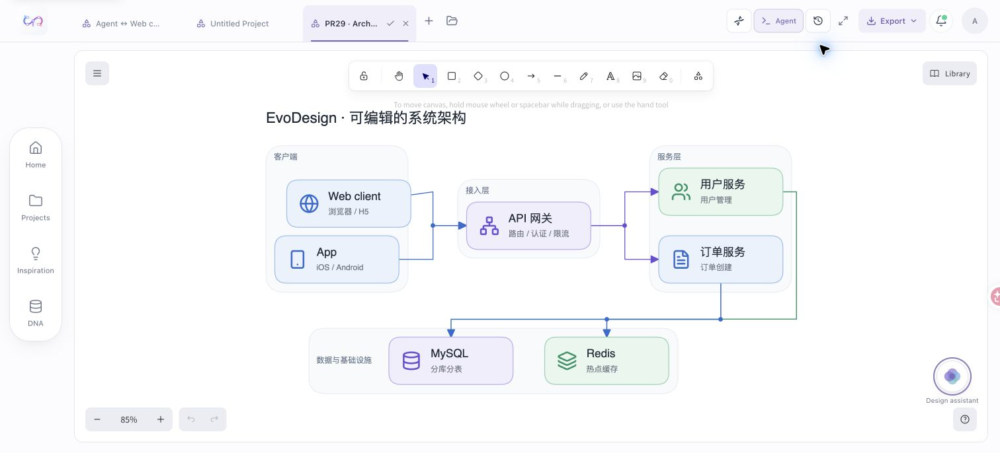

# Architecture design system integration review

Review date: 2026-11-02. Public baseline: `7ecd6bf`; contributor PR: [#29](https://github.com/GeminiLight/EvoDesign/pull/29), originally reviewed at `771cf8a` (11 contributor commits).

## Resulting behavior

The Python renderer can execute a compact architecture tier plan as uniform cards, restrained role colors, title/subtitle hierarchy, optional outline icons and orthogonal connectors. The shared treatment also covers eligible flow and area diagrams. Native canvas elements and embedded SVG assets remain editable and portable.

The template has a deliberately bounded scope. Named semantic groups, labeled relationships, feedback loops, unsupported arrowheads and ambiguous shared junctions retain the complete native scene. In particular, a shared bus must not turn `A → X, B → Y` into an apparent complete dependency matrix. Exact supplied palette values, explicit DNA, hard locks and intentional partial icon coverage take priority over automatic treatment. The static browser generator does not execute the Python layout tool.

## Review corrections

- Restore native card title bindings and connector endpoint bindings. Scoped CLI rename edits the visible title; move/delete include the registered icon and subtitle. Locked cards protect their companion text and icon bytes.
- Synchronize card parts in both the web editor and engine refinement tools, including cards without icons. Long CJK labels wrap without dropping their source text; diagram titles are not silently truncated.
- Preserve diagram-specific arrowheads and native bindings in the shared theme; reposition mind-map edge labels after rerouting.
- Carry layout plans and design constraints through the streaming backend render path as well as the batch pipeline.
- Consume project navigation handoffs once. Refresh after a human save loads the saved head, rather than replaying an old opening snapshot and raising a misleading conflict.

## Verification

Paid model generation and judging were not used. Contributor-reported experimental scores are historical evidence and were not rerun or independently reproduced in this integration.

Local checks cover backend APIs, engine rendering/verification, architecture boundaries, the standalone CLI contract, scoped native editing, frontend icon/editor contracts, lint and production builds. Regression cases include labeled edges, named boundaries, self-loops, incomplete many-to-many buses, partial/no icons, exact palette values, native locks, CJK wrapping and card companion movement/deletion.

Real Chromium export produced and visually inspected architecture and long-label PNGs. In the user's daily Chrome profile, a synthetic local project was renamed and dragged, saved, and reopened. The title, icon and subtitle moved by the same delta; native connector bindings survived. A real candidate PNG and version-checked proposal commit exercise the same saved-document boundary used by the CLI. Original projects and production accounts were not used as fixtures.

Local evidence is retained under ignored `.release-audit/architecture-pr29/`; it is not part of the distributable repository. Public and private repositories retain their own configuration, documentation and research data when synchronizing this change.

The synthetic local project below shows the edited native card after save and reopen:

