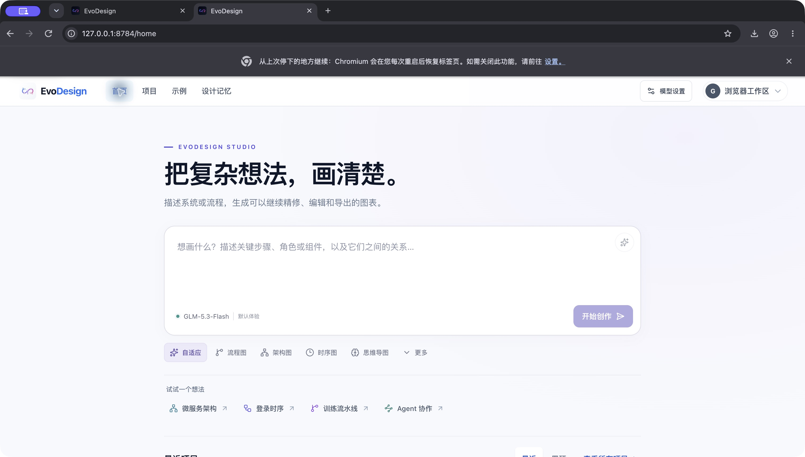

# Home and shared GLM demo validation — 2026-10-28

The home screen now centers on a prompt, a compact model selector, lightweight starters and recent-project rows. Fresh visitors to the hosted browser edition can use GLM-5.3-Flash without entering a key. Existing custom-model settings remain selected, and switching model sources preserves the saved custom configuration.

## Verification performed

- Public and dev frontend quality checks: lint, 8 icon tests, 28 editor tests, 28 browser/server tests, and normal/browser production builds passed. Public repository documentation, release and frontend contracts: 19 Python tests passed. Dev has documentation/frontend contracts but no `test_release_tools.py`; its available checks were run separately.
- Browser walkthrough on the local production build using the real GLM service: shared model configuration, architecture generation with icons, review, selection-scoped label editing, automatic save, return to Home, reopen, and SVG/PNG/Excalidraw exports passed. The exported files contained the edited label; the PNG was nonblank and the native file retained 53 elements and 8 embedded icon assets.
- Desktop light/dark appearances and a 320-pixel responsive Home viewport were visually inspected. This is targeted flow verification, not a complete accessibility audit.
- Real sequence and complex flow plans were generated and reviewed, then checked with the actual frontend normalization/layout/content-preservation functions, with icons both enabled and disabled. Coordinates were finite, nodes did not overlap, and review preserved diagram content.
- A protected Vercel preview independently completed real generation, review and local editing through `/api/model`, with no model credential in the client request.
- Real Redis atomic-reservation checks in a temporary namespace admitted exactly two of eight simultaneous requests at a concurrency cap of two, released all active leases, and enforced the daily cap. Test keys were removed afterward.

## Observed timings

| Case | Generation | Review | Scope |
| --- | ---: | ---: | --- |
| Architecture with icons | about 24 s combined | included | Browser generation, review, layout and save |
| Sequence, 4 participants / 18 messages | 11.71 s | 9.77 s | Real local relay calls |
| Complex order flow, 12 nodes / 12 edges | 12.06 s | 12.35 s | Real local relay calls |
| Selected label edit | 2.15 s | — | Real local relay call |
| Vercel architecture | 17.32 s | 26.81 s | Authenticated CLI wall time, including control-plane overhead |
| Vercel selected label edit | 10.30 s | — | Authenticated CLI wall time, including control-plane overhead |

These are individual smoke-test observations, not latency guarantees or a statistical benchmark.

## Corrections made during testing

A complex GLM response contained raw newlines inside JSON labels. Shared diagram/edit requests now use JSON output mode, and the browser parser escapes literal control characters inside quoted strings without guessing missing fields or structure. A regression test covers this case and still rejects malformed structure. The architecture starter now explicitly requests a compact five-component layout.

An explicitly selected shared source stays selected during discovery failure, so a temporary outage cannot silently spend a saved custom-provider key. The unavailable state keeps the own-model switch reachable.

## Hosted configuration and limits

Secrets use server-only `DEMO_GLM_API_KEY`, `DEMO_REDIS_URL` and `DEMO_REDIS_TOKEN`. The relay fixes the general BigModel endpoint, model and task prompts. Defaults are 2,000,000 conservatively reserved tokens per UTC day, four concurrent requests and forty requests per visitor IP per day; generation plus review uses two requests. Reservations are not refunds or provider billing measurements. Limits are shared and the app offers the own-model path when unavailable. Prompts and raw IP addresses are not stored by this relay; the provider still receives prompts to fulfill model requests.
