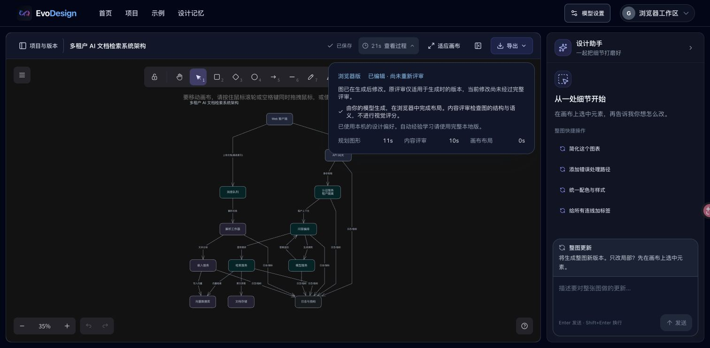

# Kimi workflow and UX follow-up — 27 October 2026

A focused real-model follow-up after the model-settings redesign. Four browser-edition workflows ran in the user's regular Chrome: complex flow with icons, architecture without icons, and sequence with icons before and after a confirmed line-style fix. Each included model generation, content review, a selected-node edit, saving, reopening from Projects, and editable Excalidraw, SVG and PNG exports.

## Connection and scope

Kimi Coding (`k3`, low reasoning effort) still rejected the browser preflight with HTTP 404 and no allow-origin header. The model-settings connection test showed an actionable error. Real requests therefore used a temporary loopback-only test connection restricted to the configured Kimi upstream and the test origins. Its key remained in the local process, never in browser settings, source or Vercel. Connection testing succeeded in 3.81 seconds through that connection.

These runs exercised the browser edition locally. They do **not** demonstrate that Kimi Coding supports direct requests from the public website. No shared proxy or model key was deployed. The saved model configuration and temporary viewport override were restored after testing.

Browser content review is a second model call over the diagram plan, not the Python visual refiner or an image-based aesthetic assessment. Local edits are explicitly marked as not yet re-reviewed.

## Observed timings

Provider times come from the temporary connection's duration log. Total is the app's rounded generation, review and client-layout time. These are individual observations, not benchmark averages or a claim that the UI changes accelerate inference.

| Case | Icons | Generation | Review | App total | Local edit |
| --- | --- | --- | --- | --- | --- |
| Order flow: parallel stock/fraud checks, retry and compensation | On | 21.92 s | 16.08 s | 38 s | 5.62 s |
| Multi-tenant document-retrieval architecture | Off | 10.77 s | 9.95 s | 21 s | 2.75 s |
| OAuth sequence, initial run | On | 8.36 s | 21.31 s | 30 s | 2.14 s |
| Same OAuth request, after line-style fix | On | 4.67 s | 13.04 s | 18 s | 3.61 s |

## Findings and fixes

- **Return-message styling was lost.** The plan schema had no line-style field, so the model wrote styling instructions into labels and all message arrows rendered solid. The schema, prompt and renderer now carry an explicit `solid`/`dashed` value. Local editing accepts the same bounded values. The second real run produced 18 messages, including nine dashed return messages, with no “dashed return” annotations in the labels. Leftward calls are not automatically treated as returns.
- **Reopening hid the process report.** Guest project listings omitted the current snapshot's saved generation report. Reopening now retains duration, review status and the post-edit caveat. A manual snapshot without a report does not inherit another version's assessment. Existing flow, architecture and sequence projects were reopened to verify this.
- **Saving was hard to see.** A compact toolbar status now shows saving/saved state and offers retry or recovery when needed. Browser saves explicitly identify their storage location in the accessible label and tooltip. The same action powers the save shortcut and the toolbar.
- **Waiting repeated itself across the workspace.** Generation keeps one stage display, and local edits use a small activity indicator while leaving the diagram visible. Irrelevant empty-state suggestions and duplicate typing bubbles are hidden during work.
- **Repeated exports covered the mobile canvas.** Identical notifications now refresh one dismissible notice instead of stacking copies. Consecutive SVG/PNG exports verified one notice.

## Integrity and UI checks

The flow contained 16 nodes, 18 connections and 12 icons; architecture contained 12 nodes, 19 connections and no icons; both sequence runs contained five participants, 18 messages, five lifelines and five icons. All four local edits changed only the selected participant/node fill and its bound text. All edited/reopened element arrays and embedded-file maps matched exactly. No unrelated geometry or connectivity changed.

All four cases exported parseable Excalidraw JSON and SVG XML plus valid PNG files. Final PNG sizes were 6976 × 1089 (flow), 2086 × 2570 (architecture), and 2470 × 3854 (sequence). Exports were visually inspected for labels, connections and icons. The initial sequence export exposed the line-style defect described above; its corrected counterpart retained dashed messages after editing and reopening.

The workspace and export controls were checked at 390 px width with no page overflow. The model-settings dialog was checked at 390 × 844 and 320 × 568, with reachable footer actions and a scrollable body. Desktop generation, editing, project navigation, saved state and reopened process reports were inspected in Chrome. This is not a comprehensive accessibility or device-compatibility audit.

Automated validation uses the repository frontend quality suite: frontend contracts, lint, icon/editor/browser checks, and full-mode plus browser-mode builds. Regression coverage includes report persistence/current-snapshot isolation, explicit sequence line styles, leftward calls and rejection of invalid edit styles.
