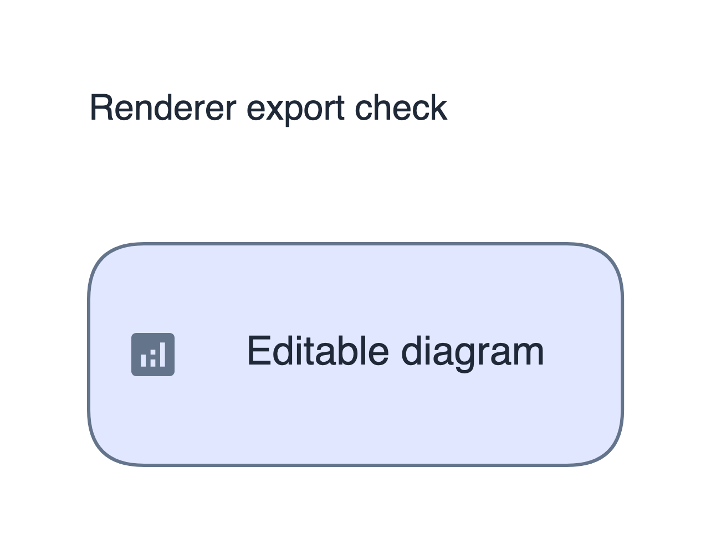
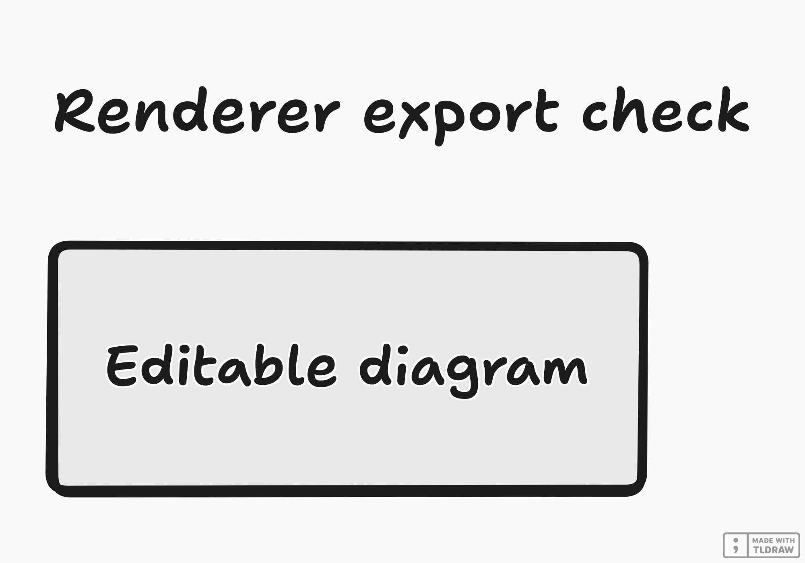

# Native export fixes

Validated on 2026-10-28. The two native-renderer corrections and their regression tests are synchronized with development commit `0e92ffa7`.

## Behavior

- TLDraw standalone text now uses `textAlign`, matching the text schema version declared by the snapshot. Legacy `align` input is accepted during conversion. Titles and annotations render instead of failing SDK validation and waiting until timeout.
- Excalidraw PNG export restores and exports the submitted scene directly. Initial editor hydration can no longer replace the export with an empty scene. Embedded icon files are passed to the editor in its supported array format and supplied directly to native export.

The changes apply to the full local renderer service. The static browser edition has its own export path.

## Validation

`./scripts/check_quality.sh all` passed 2,340 Python checks, 8 icon checks, 28 editor checks and 19 browser-mode checks, including lint, both frontend production builds, renderer typecheck and the Next.js production build. One optional TiKZ integration was skipped because this local environment does not have PyMuPDF.

The built service also passed two consecutive complete runs of `tests/integration/test_renderer_http.py`:

1. Excalidraw without icons.
2. Excalidraw with an embedded icon.
3. TLDraw with standalone text.

Each request starts a fresh rendering browser. Tests inspect pixels in the diagram area, so a valid blank PNG or only a canvas watermark cannot count as a rendered diagram. Three additional exported fixtures were inspected visually; the title, node label and optional icon were present. In total, nine fresh-browser exports completed successfully.

Fixture capture timings on this machine were 1.20 seconds for Excalidraw without icons, 0.75 seconds with an icon, and 2.27 seconds for TLDraw. These measure rendering only, without model generation.





## Re-run the HTTP checks

Start the built renderer on its usual loopback port, then run:

```bash
RENDERER_SMOKE_URL=http://127.0.0.1:3000 .venv/bin/python -m pytest -q tests/integration/test_renderer_http.py
```

For another service port, set the existing `EXCALIDRAW_RENDER_URL` and `TLDRAW_RENDER_URL` server settings to the corresponding local renderer pages when starting the service. The HTTP checks are opt-in because they require a running renderer and Playwright Chromium. They use synthetic inputs and do not require model credentials or released datasets.
