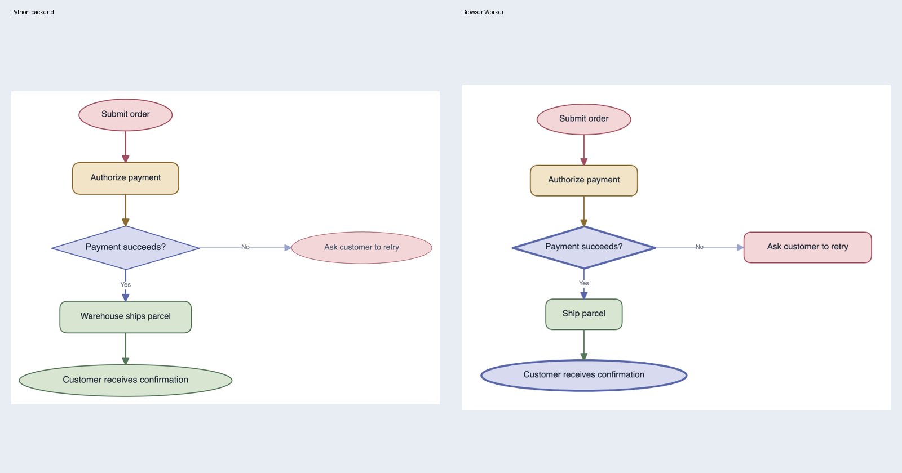

# 第三期验收报告：浏览器执行完整出图流水线

验收日期：2026-11-06。依据：`PHASE3_PLAN.md`。

结论：第三期主要实现及当时的本地自验通过。后续图标修复改变了旧录制下游提示词，算法核验也发现明确偏差；当前结论以 [算法核验报告](ALGORITHM_VERIFICATION_REPORT.md) 为准，不能将下表的历史全绿结果当作当前完全等价验收。生产部署未执行。

## 交付行为

浏览器模式已接入第二期迁移的 TypeScript 流水线。一次出图在独立 Web Worker 内依次执行结构、样式、布局、渲染、检查和按需修复；阶段事件与完整模式共用前端分发函数，最终结果共用 `DiagramResponse` 转换。取消会终止本次 Worker，释放流水线状态并中止其网络活动。

使用自有模型时，模型请求由浏览器直接发送给用户配置的服务商。共享模型使用一次出图的签名令牌转发请求。浏览器版关闭持久化、账号、设计记忆和学习，生成范围为 Excalidraw；局部编辑保留原有实现。

## 工作包与实现

| 工作包 | 结果与主要文件 |
|---|---|
| WP26 | 接续已有的 28 组网页事件录制及比较工具，详见 `notes/WP26.md`。|
| WP27 | 接续 RuntimeFS、Node/Memory 实现、平台接口与纯 JS PNG/压缩，修复 CLI 回放初始化顺序和 pytest 临时文件依赖。|
| WP28 | `PngRenderer` 接口、Node 渲染器、前端 `pipelineRenderer.ts`，使用现有 Excalidraw 导出参数与字体资源。|
| WP29 | `src/web_runtime/` 迁移网页出图编排、校验、事件、质量报告和修复；支持 FS、模型、渲染器、取消信号注入。|
| WP30 | `src/models/openai_chat.ts`、HTTP/重试对照、`api/model/run.mjs`、`shared/model-runs.mjs`；文本模型显式关闭看图评审。|
| WP31 | `src/browser.ts`、资源内嵌构建、Worker/主线程渲染桥接、本地包依赖与 Vercel 构建配置。|
| WP32 | `generateBrowserDiagram` 接入 Worker，提取完整模式事件及结果转换，删除简化的计划生成与边路由，更新阶段展示和模型设置。|
| WP33 | 同一输入分别运行 Python 业务入口和真实 Chromium Worker，使用仓库已有模型配置，总计 8 次真实模型调用。|
| WP34 | 本次实现者复跑检查并形成此报告；未执行计划中另一位独立 agent 的复审。|

### 运行时与资源

浏览器入口先安装资源和 MemoryFS，再延迟加载流水线，避免模块初始化时读取尚未安装的资源。每次生成创建新的 Worker，隔离模型工厂、文件系统、配置单例及异步上下文。已将打包器无法识别的运行时 `.ts` URL 导入改为可解析导入。

资源来自仓库内的系统提示词、公共配置、类型模式和图标，构建不读取 `.env`。构建产物记录 62 个资源、4,432,129 字节资源文本。引擎 JS 为 7,262,070 字节，gzip 为 1,262,694 字节；Worker 随首次生成加载。

公开的浏览器类型声明引用构建时生成的文件系统声明，避免前端类型检查沿源码导入默认 Node 平台。

### 共享模型与自有模型

`POST /api/model/run` 签发 HMAC 令牌，有效期 15 分钟，绑定访客。每次出图最多 40 次模型调用、400,000 预留 token 预算，调用时以 Redis Lua 原子检查本次限制、日预算和并发。预算按 UTF-8 文本字节、输出上限和每张图片的保守预留计数；这不是服务商的精确 token 账单。失败请求保留预留，防止重试绕过预算。

`POST /api/model` 仅转发白名单 Chat Completions 字段，固定服务端模型和非流式响应，限制请求体为 8 MB，只接受内嵌 PNG/JPEG 图片。保留编辑与连接检查任务，移除旧 `plan` 任务。Vercel、本地开发和 ModelScope 服务均已接入令牌路由；仅修改配置与源码，未部署。

自有模型的 key 只交给浏览器 Worker，在直连请求中使用。共享请求不会携带自有 key。文本模型可以在设置中关闭图片能力，按 backend `enable_critic=false` 语义运行，并在设置和结果报告中说明看图评审已跳过。共享演示默认使用此设置。

## 验证结果

所有命令均从对应包目录执行。构建使用 Node 24.22.1；系统默认 Node 20.11.1 不满足本机 Vite 要求，包已声明 Node >=22.12。

| 检查 | 命令 | 结果 |
|---|---|---|
| 引擎类型 | `npm run typecheck` | 通过，0 错误 |
| 全量函数及单元测试 | `npm test -- --maxWorkers=1` | 1194/1194，6 个文件通过，0 未处理错误 |
| 阶段回放 | `npm run parity:stages` | 112/112 |
| 磁盘完整回放 | `npm run parity:runs` | 36/36 |
| 内存完整回放 | `npm run parity:runs -- --fs memory` | 36/36 |
| 网页编排回放 | `npm run parity:web` | 28/28，模型请求、事件及结果一致 |
| HTTP 请求及重试 | `npm run test:http` | 45/45 |
| 渲染与裁剪像素比较 | `npm run parity:render` | 224/224；原图字节、像素完全一致；裁剪一致 224/224 |
| 浏览器依赖检查 | `npm run check:browser` | 6 个入口均无 Node 内置模块；无违规 Node 导入 |
| Worker/画布回放 | `npm run test:worker` | 3/3，包含普通出图、router、修复和取消 |
| 共享 Worker/画布回放 | `npm run test:shared-worker` | 1/1，3 次模型请求、14 个事件、36 个元素，取消通过 |
| 前端 lint | `npm run lint` | 通过 |
| 编辑器与图标 | `npm run test:editor`、`npm run test:icons` | 通过 |
| 浏览器及代理安全 | `npm run test:browser` | 43/43 |
| 浏览器生产构建 | `npm run build:browser` | 通过 |
| 默认前端构建 | `npm run build` | 通过 |

HTTP 对照包括模型参数、vision、tools、JSON 模式、流式参数以及超时、连接失败、限流、配额用完、空流、无效 SSE 和中途错误的重试行为。请求比较排除 User-Agent、SDK 版本及传输层自动生成头，认证与请求 JSON 保持比较。

函数报告覆盖 138 个模块，34,504 条向量通过、0 失败；另有原有适配器明确排除的 458 条向量，主要是由完整流程回放另行覆盖的异步渲染/模型调用，以及本期范围外的记忆、tldraw 和无法重放 monkeypatch 的 CLI。未将这些排除计为执行通过，也未增加新的排除规则。

代理测试覆盖正常流程、无令牌、伪造/过期/跨访客令牌、次数及预算耗尽、跨域、超大请求、外链图片、多余字段过滤、编辑及连接检查兼容。Worker 共享额度测试使用离线令牌与模型替身，代理本身另由安全测试覆盖；未消耗真实 GLM 共享额度。

早期全量 Vitest 的断言通过，但有两次 worker RPC 通信超时，因此没有将这些运行记为成功。降低并发后的 1194 项断言仍全部通过，同时复现相同通信错误；原因是函数向量和整数 ID 回放连续执行同步计算，超过 RPC 回复时限。回放脚本已在独立向量或用例之间让出事件循环，断言、向量及阈值均未减少；本报告使用修复后的最终结果。

### 渲染判定

112 组最终 manifest 各验证 product、analysis 两种模式，共 224 组。每组分别由 3001 渲染服务和 Chromium 中的前端导出器生成 PNG。必须尺寸相同，最大通道差大于 16 的像素占比不超过 0.5%；两边执行 smart crop 后，裁剪说明和裁剪框必须一致，裁剪后的图片也必须满足同一像素阈值。

最终 224/224 通过：224 组原图尺寸、PNG 字节和解码像素完全一致，最大通道差为 0；224 组裁剪说明、裁剪框和裁剪后像素比较全部通过，无警告、无超阈值用例。原始报告为 `reports/wp28/summary.json`。

### 修复旧函数 fixture 的临时目录依赖

此前三条向量依赖已被 pytest 轮转删除的临时文件。新增捕获脚本在原有 Python 测试函数入口记录文件内容，原测试 145/145 通过。`test/fixtures/runtime_inputs.json` 随源码保留，函数回放按测试及调用次序安装一次性 MemoryFS 覆盖，结束后恢复。期望结果和原始路径字符串均保留，指纹仍精确比较。

## 真实模型冒烟

输入为订单提交、支付判断、失败重试、成功发货和确认通知的流程图。两边使用已有 `.env` 模型配置，模型 key 未写入报告或产物。

| 侧 | 耗时 | 真实模型调用 | 质量结果 | 自动修复 |
|---|---:|---:|---|---|
| Python 完整业务入口 | 100.47 秒 | 4 | `passed`，9.0 分 | 无需修复 |
| Chromium + Worker | 85.755 秒 | 4 | `passed`，8.6 分 | 无需修复 |

耗时为整次脚本的墙钟时间，包含各自初始化及产物处理，不能据此推断性能提升。Python 通过进程内 `WorkflowGenerateService.generate_without_render_streaming` 驱动同一业务入口，未额外启动 HTTP backend；该检查不覆盖登录、DB、SSE 网络链路。浏览器使用真实 Chromium 和真实模型网络请求。

产物保存在 `wp33/python/`、`wp33/browser/`；`wp33/comparison.png` 为并排图。已目视确认两边的支付分支、失败路径和成功路径均可读，未见空白输出或浏览器特有错误。真实模型输出有随机性，不做像素一致判定。修复路径由离线 Worker 回放及网页编排回放覆盖。

## 遗留与验收范围

### 补充：原会话经典用例的真实生成比较

2026-11-06 从 reclaude 会话 `152ffb09-db99-49d3-8db6-6f9bc8f98057` 恢复电商、RAG、CI/CD、产品经理思维导图、HCAI 五个原始输入，在 Chromium + Worker 中直接调用当前配置模型重新生成，并目视比较仓库内历史 Python CLI 图片。本次不是旧回复回放，也没有证明历史模型版本与当前版本相同。

| 用例 | 实际观察 |
|---|---|
| 电商 | 分层、组件与共享基础设施接近；图标缺失、颜色和比例变化；重跑成功，自动修复 1 项。|
| RAG | 六个组件与五条关系保留，但旧图的分区、图标和副标题未充分复现。|
| CI/CD | 主链、失败通知、人工确认、健康检查失败回滚保留；纵向布局变为横向折行；重跑成功。|
| 产品经理思维导图 | 四个一级分支和十一项子能力保留，连接样式和排布变化。|
| HCAI | 新增连通的人机反馈、工具结果和记忆；审批前置与价值适应的可见表达仍不足。|

正式五例共七次尝试，电商和 CI/CD 首次失败、原样重跑成功；首次诊断不足，不能确定归因。另一次缩写论文 fixture 尝试失败，因原始长文临时文件已不存在，不计入严格同输入比较。总计八次运行、27 次真实模型请求。五个最终结果均返回 `passed`，模型评分分别为 8.9、7.5、9.0、9.2、7.1；这些分数不是与历史图的相似度。

图标缺口随后已同步修复：Python 和 TypeScript 均兼容节点顶层 `icon`，同时修正内置 `outline_*` 名称校验。真实 Chromium 重新生成确认电商 9 个图标、RAG 6 个图标均以 SVG 内嵌进入画布。新增开关、选择性覆盖、优先级及渲染测试后，TypeScript 1,199 项、Python 相关回归 125 项通过。该主动行为变化使旧 paper cassette 的布局提示词失配；当前回放为完整 pipeline 35/36、网页 27/28，保留原基准，详见算法核验报告。

[修复后电商图](wp33/icons/ecommerce.png) · [修复后 RAG 图](wp33/icons/rag.png) · [电商图标清单](wp33/icons/ecommerce.json) · [RAG 图标清单](wp33/icons/rag.json)

结论收紧为：相同回复与 manifest 下的迁移/渲染一致已验证；真实模型下主要结构能够接近，但不能保证任意输入的视觉完成度与旧版一致，也不能保证一次生成成功。后续优先处理图标字段兼容、可见副标题，以及审批/反馈等必要关系的可见性。复跑工具为 `tools/wp33/classics-browser.ts INPUT.json OUTPUT_DIR`。

| 级别 | 项目 | 影响与处理 |
|---|---|---|
| P2 | 独立复审尚未执行 | 计划中的另一位未参与实现的 agent 没有复跑。本报告记录实现者自验，不能冒充独立验收。|
| P2 | 首次生成需要加载完整引擎 | 引擎 gzip 约 1.26 MB，另有编辑器与渲染资源；慢网首次生成可能有额外等待。已按需加载 Worker。|
| P2 | 外部模型的浏览器访问能力 | 自有服务商须支持浏览器 CORS；本次只对已有模型配置做了真实调用，其它服务商依赖用户配置。|
| P3 | 真实共享额度与生产部署未验 | 路由、预算和 Worker 各有离线测试；生产 Redis、域名和平台函数打包尚未线上验证。|
| 范围限制 | unified、tldraw、账号与记忆 | backend 网页分步入口本身拒绝 unified，已按相同错误行为回放；本期不新增这些能力。|

本报告描述本地验证结果；未执行生产部署。旧 3000 渲染服务未改动；验证使用 3001。
