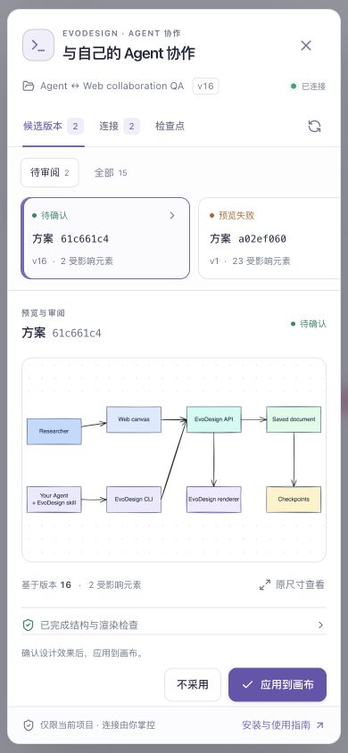
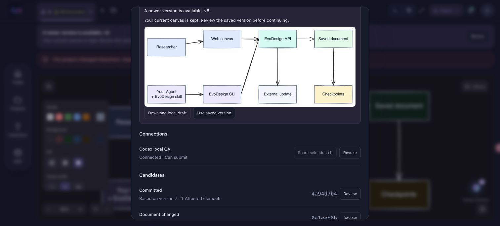

# Agent CLI v1 验收记录

2026-10-30，后端版 Excalidraw。使用独立 CLI 安装、真实 HTTP、SQLite 测试账号、渲染服务与日常 Chrome 验收；数据均为合成测试项目。公开浏览器版只提供引导，未部署共享后端。

## 实际协作路径

| 场景 | 观察到的结果 |
| --- | --- |
| CLI 配对 → 创建 → PNG → Web 审阅 | 创建真实可编辑图，Web 接纳后成为正式版本 2 |
| Web 拖动 → CLI 局部编辑 | 保存人工位置，再改另一节点；无关原生元素保持一致 |
| 两个候选同时基于版本 4 | 第一份提交成功，第二份返回冲突，候选仍保留 |
| 检查点恢复 | 版本 2 的内容保存为新版本 6，计数器不回退 |
| Web 离线草稿与外部更新并发 | 外部版本 8 到达时保留本地草稿；下载文件与正式文档坐标确实不同；取消及确认替换均成功 |
| 共享选区 | 范围外操作拒绝；重新共享后，旧交接不能自动提交；新交接可以提交 |
| 原生锁定 | CLI 改字与恢复旧场景均不能修改当前锁定元素 |
| 候选过期 | 仅将合成候选的到期时间调到过去，真实 HTTP/CLI 拒绝提交；未以等待七天冒充测试 |
| DNA | 账号规则、项目覆盖、停用项目规则、恢复继承均与 CLI 一致；约束变动使旧候选失效 |
| 最小新手示例 | 新空白项目创建两节点候选；预览权限连接直接提交被拒，由 Web 接纳；非空项目被示例脚本拒绝 |
| 新版移动端审阅 | 在中文手机布局中应用候选，正式版本推进至 17；只有目标节点及绑定文字改变，人工位置和锁仍保留 |
| 连接与恢复界面 | 配对后刷新仍指向正确项目；取消撤销有效；实际撤销后 CLI 凭据失效；恢复按钮先生成可审阅候选 |

历史查看保护另有远程文档策略自动检查；以上表格未将未执行的手工场景列为浏览器实测。

## UI / UX

方案审阅、连接与检查点分开。桌面使用列表与大预览；手机使用横向方案列表与单列审阅。支持原尺寸查看，图片成功加载前不能应用。主要操作保持可见，失败记录可移至历史，连接撤销前可取消。中英文、浅色与深色，以及 320 / 390 像素宽度已实测；320 像素下文档宽度为 320，弹窗宽度为 304，没有页面横向溢出。

## 本地检查

| 检查 | 结果 |
| --- | --- |
| Architecture | 148 passed |
| Backend | 567 passed |
| Engine | 1330 passed |
| CLI 与确定性编辑 | 25 passed |
| Evaluation | 167 passed |
| Baselines | 75 passed, 1 skipped |
| User memory | 40 passed |
| Frontend | 12 Python contracts；lint、icons、editor、browser checks 与两种生产构建通过 |
| Renderer | 16 contracts；typecheck 与 Next.js 生产构建通过 |
| 独立 CLI 环境 | 仅安装 CLI 与测试依赖；12 passed；隔离导入确认引擎不存在 |
| Skill | quick_validate 通过 |

构建仍提示既有的大 JavaScript 包体积；后端依赖保留一条 `crypt` 弃用提示。真实 embedding 下载/推理集成不属于离线质量门禁，本轮未运行。

PNG 渲染还验证了缺失渲染器浏览器依赖时的失败路径：候选失败，正式文档保留；安装渲染器要求的依赖后，新候选通过。该依赖用于服务端图片生成，界面验收使用日常 Chrome。
