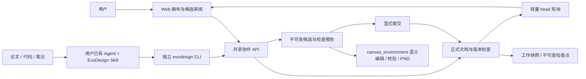

<!-- Last verified: 2026-10-30 | Current stage: Agent CLI v1 implementation and release verification -->

# Agent CLI v1：架构与实现

首版代码已落地。用户指南见 [中文](../../docs/agent-collaboration.zh-CN.md) / [English](../../docs/agent-collaboration.md)，命令与 Skill 契约见 [配套说明](agent-cli-v1-cli-and-skill.md)。本文记录实际边界，不把公开浏览器版当作已托管的后端版。

## 用户得到的协作方式

用户在后端版 Web 打开一个 Excalidraw 项目，把自己的终端 Agent 连接到这个项目。Agent 理解论文、代码和材料，通过轻量 CLI 准备语义操作；EvoDesign 负责确定性编辑、检查、渲染和保存。用户可在画布上接着改，Agent 下一轮重新读取保存结果。

Skill、CLI、Web 共用同一份正式文档，不分别维护三份图。Skill 不保存事实状态，也不启动额外 Agent 会话；Web 不成为 CLI 的远程控制桥。

| v1 已实现 | 后续适配 |
| --- | --- |
| 后端版、已登录、单项目连接、Excalidraw | 纯浏览器项目桥接、TLDraw 编辑 |
| 独立 Python CLI、仓库 Skill、JSON 协议 | MCP、其他语言客户端、自动安装到各宿主 |
| 六类语义操作、真实 PNG、候选、提交、恢复 | 任意原生 JSON 编辑、复杂分组、全局自动布局 |
| 轮询同步、显式选区交接、未保存草稿保护 | 光标同步、CRDT、自动后台唤醒 Agent |
| 保留冲突候选，重新读取后重做 | 自动三方合并、CLI 委托生成任务 |

## 实际模块

| 模块 | 职责 |
| --- | --- |
| `cli/` | 独立发行包，只依赖 httpx；配对、profile、HTTP、命令、JSON 与退出码 |
| `skills/evodesign/` | 读取上下文、限制范围、看图、冲突和不确定写入的工作方法 |
| `backend/app/api/agent_deps.py` | 在协作 API 接受项目范围凭据，普通账号 API 仍使用原 JWT |
| `backend/app/api/v1/endpoints/agent.py` | 连接、文档、上下文、候选、预览、历史与恢复入口 |
| `backend/app/models/agent.py` | AgentConnection 与 AgentProposal 持久化 |
| `agent_connection_service.py` | 短时配对、一次性领取、项目绑定、权限与到期 |
| `document_service.py` | 归属、有效 DNA、锁定、稳定约束摘要与节点索引 |
| `agent_proposal_service.py` | 幂等候选、租约、真实检查、提交与恢复 |
| `agent_artifact_service.py` | 私有 PNG 缓存的受限回收，不跟随符号链接 |
| `document_commit_service.py` | 所有正式文档写入共用的版本条件更新与快照处理 |
| `schema_service.py` / `diagram_persistence_service.py` | 人工保存与原有生成接入同一提交边界 |
| `evo_diagram/canvas_environment/editing.py` | 六类确定性 Excalidraw 操作及锁定保护，经公共 facade 暴露 |
| `frontend/src/services/agentApi.ts` | Web 的协作 API、超时、身份变化与私有 PNG 请求 |
| `useRemoteDocument.ts` / `remoteDocumentPolicy.ts` | 轻量轮询、历史视图与草稿保护、显式采用 |
| `AgentConnectPage.tsx` / `AgentConnectionPanel.tsx` | 项目批准、连接、候选、真实预览、检查点与草稿比较 |
| `useDiagramSync.ts` / `WorkspacePage.tsx` | 接入既有保存、画布、选择、生成和历史流程 |
| DNA API、`useRuleLibrary`、`ProjectDnaDrawer` | 统一已保存规则的来源、项目覆盖和关闭后的继承 |

后端服务路径均相对于 `backend/app/services/`。新交互沿用现有颜色变量、按钮、对话框和中英文文案，不建立另一套工作台。

## 正式写入契约

`Project.version` 是单调递增的文档与设计约束版本。人工保存、生成结果、Agent 提交、恢复都经 `commit_document` 的 `WHERE project_id / user_id / version` 条件更新。缺少版本不写入；过期版本返回冲突。

DNA 更新也推进版本。项目规则只影响所属项目；账号规则保守推进该用户全部项目版本。设计类型或画布引擎的变更需要版本；非空项目不能直接切换引擎。单独重命名不替换图。

`Project.current_snapshot_id` 明确指向当前正式快照，避免把创建时间最新的历史记录误作正式版本。它是逻辑指针，不引入 Project ↔ Snapshot 外键循环。

`Snapshot.is_checkpoint` 区分检查点和工作快照。提交会冻结当前快照，并创建新检查点；之后的自动保存另建工作快照。仅当前非检查点工作快照可以原地更新，编辑其他历史快照会另建记录。恢复从本项目检查点产生候选，提交后创建新版本，不回退计数器。

已有生成请求针对现有项目时必须提供 `base_version`。如果生成期间图已改变，结果保存为 AI_GEN 候选，不覆盖新图；前端不把未提交结果当成新的保存基线。原生硬锁在 Agent、生成和恢复的正式提交处统一检查，包括绑定文字和锁定图片数据。

## 文档与上下文

- `GET /projects/{id}/document/head` 只读版本与当前快照字段，不加载场景 JSON，供可见页面约每两秒轮询。
- `GET /projects/{id}/document` 返回版本、原生场景、节点索引、有效 DNA、锁定 ID、约束摘要、能力与 Web 链接。读取末尾核对版本，避免拼接不同时刻的规则与文档。
- `GET /projects/{id}/agent-context` 返回保存的规则与交接状态。存在项目规则时使用项目规则；没有项目规则时继承账号规则。只暴露启用的规则。
- 选区由 Web 对目标连接显式发布，先保存，绑定文档版本，十分钟到期。空、过期或旧版本选区不能退化成全图。
- 使用交接的请求携带 `context_version`；候选保存它，自动提交再次核对原连接、交接版本和到期。Web 所有者仍可明确审阅并接受候选。
- 客户端未同步缓存不成为 Agent 约束；全局生成也先等待偏好保存，读取服务端有效 DNA。关闭项目覆盖要删除服务端项目规则，不能只清理本地缓存。

## 候选、渲染和权限

候选保存基础版本、基础场景、约束摘要、不可变候选场景、实际受影响 ID、检查报告、过期和提交结果。`(project_id, operation_id)` 唯一，内容摘要和连接必须一致；相同请求重复创建返回原候选，不能把同一个 ID 用于另一请求。

状态为 queued → checking → ready → committed，也可能 failed、rejected、expired。冲突保留原候选；正式版本不会自动合并。

检查由 `proposal get / wait` 或 Web 审阅请求启动或恢复，不宣称有独立后台 worker。每项目最多两个有效检查租约，租约六十秒；一次请求等待渲染最多四十五秒，进程中渲染受并发槽限制。崩溃后的过期租约最多恢复两次；迟到结果按租约 ID 条件更新，不能覆盖新尝试。明确失败后应准备修正候选，不把刷新按钮伪装成已实现的重试队列。

结构校验和几何审计复用 `canvas_environment`，真实 PNG 复用既有渲染器。报告明确区分 render passed 与 visual_review unverified。Agent 使用宿主看图能力，用户在 Web 看真实图片。首版不为外部 Agent 候选另调用视觉模型。

候选七天到期。PNG 只在认证后提供；缓存位于前端公开目录之外。预览请求机会式回收七天前生成的 PNG，每次最多六十四个，不跟随链接或删除非生成文件。候选与检查点的数据库内容不因 PNG 回收而丢失。项目删除后不再授权访问，即使已有渲染完成也不能重新建立已删除记录。

配对十分钟有效；device secret 与访问 token 只保存摘要，访问 token 只在领取时返回。访问限一个项目，二十四小时后到期，无静默续期；`can_commit` 单独控制提交。凭据不能用于普通账号、全项目列表或 DNA 写接口。提交再次以数据库条件检查连接状态，防止认证后撤销仍写入。

## 六类语义操作

新增节点、连接、改字、改样式、移动节点、删除节点。输入限制为明确 ID、有限坐标、受支持形状和样式字段，不开放 JSON path。批量最多一百条，原场景不就地修改。

元素范围包含其绑定文字；修改现有箭头或邻居绑定也必须在声明范围内。元素范围可以创建所属节点的绑定文字，新独立节点和新连接需要项目范围。不能仅因 scope_violation 就扩大用户任务范围。

移动保留其他对象，只移动所属文字和关联端点；垂直连接使用相向端口。原生对象、样式、文件和人工位置保持在同一场景中。

## Web 接入与冲突恢复

页面可见时检查 head，隐藏时暂停，网络失败时退避。拿到文档后再次检查项目、账号、版本、保存状态、草稿和历史视图，防止等待期间用户切换状态。

画布干净时采用新正式版本；有未保存修改时暂停自动保存并保留当前内容。Agent 面板显示新正式版本的 PNG，可下载本地 .excalidraw 草稿，明确确认后才采用。下载与采用是不同操作，取消确认继续保留草稿。新版本再次变化时，必须先刷新比较。

历史查看不会自动变成最新版本。旧候选在界面标记“设计已改变”，不提供误导的直接接受动作。Agent 应重新读取并准备新候选，不能把旧场景改一个版本号提交。

## 迁移、验证与发布边界

新 Alembic revision 为 `a61030agentv1`；受 Alembic 管理的部署先迁移再启动。运行时 bootstrap 补齐文档版本列、检查点列和当前快照关联：只关联与正式 schema 相等的历史记录，无匹配时从正式文档补工作基线，不猜测来源。旧 AI_GEN 快照作为检查点保留。不要对未核对的数据库盲目 stamp。

必要检查包括 backend、architecture、engine、CLI、frontend lint / icons / editor / browser / 两种构建，以及 renderer。Standalone CLI CI 单独安装 wheel 与 pytest，并在 isolated Python 模式确认引擎未安装。实际验收使用安装后的 CLI、真实 HTTP/PNG 和日常 Chrome，覆盖候选审阅、人工续编、版本冲突、草稿下载/采用、范围、锁定、DNA、过期和恢复。

现有 Vercel 只部署浏览器版。更新其前端后，Agent 入口说明后端版要求并链接指南；不能宣称数据库、凭据与 CLI 同步已随静态前端上线。远程完整后端的托管与 MCP 后续适配不在此版部署范围。
