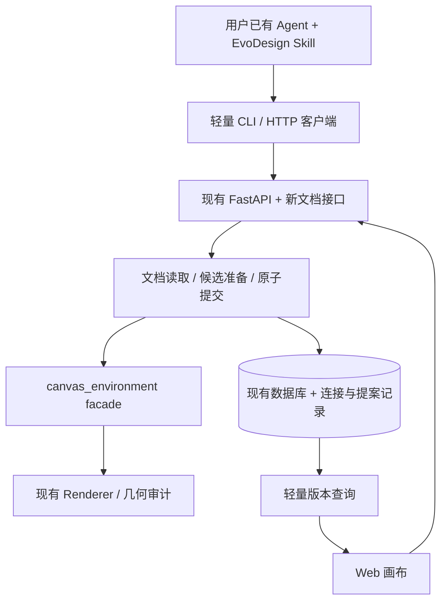

<!-- Last verified: 2026-10-30 | Current stage: Agent CLI v1 planning -->

# Agent CLI v1：实施方案

本文是待实现方案，文件与接口表中的“新增”均尚不存在。现状依据当前代码核对；旧架构文档仅作导航。CLI 契约、使用实例与 Skill 草案见 [CLI 与 Skill 设计](agent-cli-v1-cli-and-skill.md)。

## 1. 第一版交付结果

用户在 Web 新建或打开一个 Excalidraw 项目，将自己的终端 Agent 连接到该项目。Agent 读取已保存的图、设计约束与明确共享的选区，自行设计并提交候选修改；EvoDesign 校验、渲染、保存版本，Web 接收结果。用户手动改图后，Agent 能基于最新版本接着改。

首版选择“外部 Agent 设计，EvoDesign 执行与呈现”。现有生成入口继续工作，但 CLI 的委托生成命令后置，避免同时建设通用后台生成任务系统。

| 首版必须完成 | 后续再做 |
|---|---|
| 有后端、已登录、单项目连接；Excalidraw 编辑 | 纯浏览器项目桥接、TLDraw 编辑 |
| 独立轻量 CLI + 仓库维护的可分发 Skill | MCP 适配、自动安装到各种 Agent |
| 读取、语义操作、候选预览、提交、历史、恢复 | 任意原生 JSON 导入、复杂分组、自动整图重排 |
| Web 版本轮询、显式共享选区、草稿保护 | 实时选区跟随、光标同步、CRDT、自动后台唤醒 Agent |
| 明确版本冲突、保留候选、人工选择 | 自动三方合并 |

验收场景：从一个空项目画出 6–10 个节点的架构图 → 用户移动节点 B 并保存 → Agent 只改节点 A 的标题 → 双方修改都保留；再人为制造同时提交与未保存草稿，证明不会静默覆盖。

## 2. 代码现状与必须处理的缺口

| 现有位置 | 已有能力 | 首版改动理由 |
|---|---|---|
| [schema_service.py](../../backend/app/services/schema_service.py) | 条件 UPDATE、版本递增、快照保存 | `version` 可省略；Excalidraw 为全量替换；自动保存直接覆盖旧快照 |
| [diagram_persistence_service.py](../../backend/app/services/diagram_persistence_service.py) | 生成落库、快照、版本递增 | 写已有项目时未用期望版本作条件，可能盖掉生成期间的人工修改 |
| [diagram_stream_service.py](../../backend/app/services/diagram_stream_service.py) | 独立事务保存流式结果 | 需区分生成成功与保存冲突，并保留未提交结果 |
| [useDiagramSync.ts](../../frontend/src/hooks/useDiagramSync.ts) | 自动保存队列、签名、防回写、409 暂停、恢复状态 | 缺外部更新读取及统一应用入口 |
| [WorkspacePage.tsx](../../frontend/src/pages/WorkspacePage.tsx) | 选区、局部编辑、项目切换 | 状态集中在大页面，应通过新 hook 接入，不继续堆放网络逻辑 |
| [project_service.py](../../backend/app/services/project_service.py) | 项目元信息、历史查询与删除 | 最新快照按创建时间推导；画布类型可直接改；删除需同步清理新增子记录 |
| [dna_rule_service.py](../../backend/app/services/dna_rule_service.py) / [apiDiagramService.ts](../../frontend/src/services/apiDiagramService.ts) | 后端有 DNA 存储，前端从本地缓存拼入生成请求 | Agent 要读取已保存的有效规则；规则变化必须使旧候选失效 |
| [auth_token_service.py](../../backend/app/services/auth_token_service.py) | JWT 到用户身份解析 | 当前不做项目范围授权，不能把缩小权限的 CLI 凭据直接当普通 JWT 使用 |
| [canvas_environment](../../evo_diagram/canvas_environment/__init__.py) | 稳定的转换、审计、渲染边界 | 复用公开 facade；不让 API、CLI 直接依赖 render_engine 内部实现 |
| [pyproject.toml](../../pyproject.toml) | 引擎发行包和多项重依赖 | CLI 独立打包，安装时不下载模型、向量库或训练相关依赖 |

## 3. 部署和调用边界

新增模块与现有后端一起部署。CLI 只调用 HTTP，不访问数据库、不运行模型、不替 Web 启动 Agent 进程。以后 MCP 调用同一套服务与契约，不通过执行 CLI 子进程来重做业务逻辑。

正式文档是 `Project.latest_schema + Project.version`。候选存在独立提案记录里；生成候选和渲染都不能改变正式文档。

## 4. 模块改动清单

下列路径是建议实现位置；单个文件可按实际代码体量拆分，不要求建立新框架。

| 层 | 新增 / 修改模块 | 职责 |
|---|---|---|
| 后端读取 | 新增 `services/document_service.py`、`schemas/document.py`、`api/v1/endpoints/document.py` | 一致读取文档、轻量 head、有效 DNA、能力表和上下文 |
| 后端提交 | 新增 `services/document_commit_service.py`；修改 `schema_service.py`、`diagram_persistence_service.py` | 集中期望版本检查、版本递增、快照策略和结果元数据；不把 HTTP 请求传入服务 |
| Agent 编辑 | 新增 `services/agent_proposal_service.py`、`schemas/agent_proposal.py`、`api/v1/endpoints/agent_proposal.py` | 操作批次、候选、预览、提交、拒绝、历史恢复 |
| 画布操作 | 新增 `evo_diagram/canvas_environment/editing.py`，经包 facade 导出 | 确定性语义操作，维护形状、文字、连线绑定及实际修改范围 |
| 候选预览 | 新增 `services/agent_preview_service.py` | 调用 facade、存放受保护的预览、限时执行与有界恢复；不做 VLM 精修 |
| 连接授权 | 新增 `services/agent_connection_service.py`、`schemas/agent_connection.py`、`api/v1/endpoints/agent_connection.py` | 配对、项目范围凭据、撤销、显式交接上下文 |
| 身份依赖 | 修改 `api/deps.py`，可拆新增 `api/agent_deps.py` | 新文档/提案接口接受 Web 用户或 AgentActor；普通账号接口仍只接受既有用户认证 |
| 数据模型 | 新增 `models/agent_connection.py`、`models/agent_proposal.py`；修改 `models/project.py`、`models/snapshot.py` | 连接、提案、当前快照指针、检查点标记；补模型注册和迁移 |
| 项目生命周期 | 修改 `services/project_service.py`、`schemas/project.py` | 当前文档指针返回、画布切换的版本保护、删除连接/提案和预览文件 |
| 路由 / 契约 | 修改 `api/v1/router.py`、`scripts/generate_frontend_api_contract.py` 及生成产物 | 注册新接口；扩展生成器实际收录的模型，不手改生成 TypeScript |
| Web API | 新增 `services/agentApi.ts`；修改 `backendApi.ts`、`apiDiagramService.ts` | 新接口适配、结构化冲突、生成请求附带版本 |
| Web 状态 | 新增 `hooks/useRemoteDocument.ts`、`hooks/useAgentConnection.ts`；修改 `useDiagramSync.ts` | 轮询、远端应用、草稿保护、共享选区和连接生命周期 |
| Web 约束 | 修改 `hooks/useRuleLibrary.ts`、`services/guestStorage.ts` 和相关 DNA 同步调用 | 等待偏好同步、项目覆盖关闭语义、已连接项目的有效规则一致性 |
| Web 界面 | 新增 `components/Workspace/AgentConnectionPanel.tsx`、`AgentProposalPanel.tsx` | 连接、提案预览、接收/拒绝、冲突提示、检查点恢复 |
| Web 接入 | 修改 `WorkspacePage.tsx`、`frontend/src/main.tsx`、`types/api.ts`、i18n | 连接批准页、项目面板、类型与中英文文案；复用现有 `workspace?project=` 恢复入口 |
| CLI | 新增 `cli/pyproject.toml`、`cli/src/evodesign_cli/` | 独立发行包 `evodesign-cli`，命令名 `evodesign`；仅 HTTP 客户端与必要标准库 |
| Skill | 新增 `skills/evodesign/SKILL.md` 和按需 references | 作为产品随仓库维护的分发源；实施时不默认安装到开发者个人技能目录 |

## 5. 数据模型与状态

### 5.1 AgentConnection

字段：`connection_id`、`user_id`、`project_id`、`status`、配对短码摘要、`device_secret_hash`、`access_token_hash`、权限集合、批准模式、过期/撤销时间、`context_json`、`context_version`。

- 配对阶段 user/project 可空；用户在 Web 批准时绑定唯一项目，可先复用现有接口创建空项目。
- 首版凭据为独立随机不透明 token，服务端只存摘要；所有数据接口同时检查项目归属、连接状态和权限。普通 JWT 解析器不得接受它。
- 令牌仅允许绑定项目的文档、提案和交接读取；不开放全账号、其他项目、模型密钥或内部思考链读取。
- `context_json` 是显式交接快照：选中 ID、声明锁定 ID、文档版本、发布时刻、到期时刻；首版有效期 10 分钟，不包含未保存画布。连接 ID 不是秘密，不能单独充当权限。

### 5.2 AgentProposal

字段：`proposal_id`、`project_id`、`connection_id`、`author_kind`、`operation_id`、`request_hash`、`base_version`、完整 `base_schema`、`constraints_hash`、`context_version`、操作列表、不可变 `candidate_schema`、实际变更清单、状态、检查报告、预览引用、租约/尝试次数、`committed_version`、`committed_snapshot_id`、创建/过期时间。内部 Web 生成结果的 connection_id 可空，author_kind 区分 AGENT、AI_GEN 和 HUMAN；幂等键对内部任务另按用户/项目和请求 ID 保证唯一。

- 唯一约束 `(connection_id, operation_id)`；相同 ID + 相同请求返回原提案，相同 ID + 不同请求返回冲突。
- 创建提案时保存基础画布，不能只依赖可被自动保存覆盖的历史快照。候选准备完成后不再原地修改，重做产生新提案。
- 状态：`queued → checking → ready → committed`；另外有 `failed / conflicted / rejected / expired`。冲突保留原候选；可读取后重做，不能强行覆盖。
- 预览文件在仓库外运行数据目录，受项目鉴权保护，不暴露公共静态目录、任意文件路径或带 token 的 URL。
- 同项目最多 2 个候选检查并行；任务租约 60 秒，渲染总超时 45 秒，最多 2 次技术失败尝试。进程重启后恢复过期租约的检查；候选默认保留 7 天。参数集中为服务常量，后续有需要再开放配置。
- 首版任务仅覆盖确定性操作、几何检查与预览；不建立通用 Agent 任务系统，也不自动启动模型调用。
- 任务完成写入必须校验当前租约标识；旧 worker 超时后的迟到结果不能覆盖新尝试。项目删除、撤销或提案过期时停止尚未完成的检查，清理文件采用受控目录内的幂等回收。

### 5.3 Snapshot 检查点

新增 `is_checkpoint: bool = false`。Agent 提交、显式恢复、用户明确保存版本创建检查点；历史生成快照可按 `edit_source=AI_GEN` 回填为检查点。

自动保存遇到检查点时，创建以它为父的新工作快照，返回新 ID；之后可继续覆盖工作快照。检查点的 schema、来源和报告不能被自动保存改写。Agent 提交前还要保存当前正式画布的检查点，确保恢复到提交前状态，整个过程与提交同事务。

`edit_source` 新增业务值 `AGENT`，现有字符串列可容纳；客户端处理未知来源须回退通用标签。报告不继承旧图的“已通过”结论，首版区分结构/渲染/几何结果和未执行的视觉评审。

`Project` 增加 nullable `current_snapshot_id`，提交、生成落库和自动保存都在同事务更新它，避免把“创建时间最新的历史快照”当作当前正式文档。列表、document/head 和历史恢复都使用该指针。迁移仅关联 schema 与 latest_schema 相符的快照；无法匹配时从正式文档补一份工作快照，不猜测历史来源。若使用指向 Snapshot 的外键，显式指定双向 ORM 关系的 foreign_keys 并验证 SQLite 迁移；删除项目时先断开指针再清理子记录。

数据库变更通过新增 Alembic revision（基于实施时实际 head）提交；同时保持 [bootstrap.py](../../backend/app/db/bootstrap.py) 的旧库兼容与模型注册。已有无版本表数据库必须先核对 schema 再纳管，不盲目 stamp，也不改历史迁移。

## 6. 读写协议

统一接口前缀为 `/api/v1`。所有响应带协议版本 `1`；领域对象沿用 `project_id / snapshot_id / canvas_library / version` 命名。

| 方法 / 路径 | 作用 | 关键约束 |
|---|---|---|
| `POST /agent/connections` | 发起配对，返回批准 URL、短码和轮询凭据 | 无登录；限流；不能预先得到项目数据 |
| `GET /agent/connections/{id}` | Web 批准页与 CLI 查看连接状态 | 登录用户或该连接凭据；配对中不暴露其他账号信息 |
| `POST /agent/connections/{id}/approve` | Web 登录用户绑定项目、批准权限 | 校验短码、归属、过期；可创建空项目后批准 |
| `POST /agent/connections/{id}/claim` | CLI 用配对秘密轮询并一次领取访问凭据 | 批准后原子领取；不把秘密放进 URL |
| `DELETE /agent/connections/{id}` | 撤销连接 | 用户或该连接自身；立即阻止之后读取和提交 |
| `PUT /agent/connections/{id}/context` | Web 发布已保存选区上下文 | 用户认证；先保存成功，校验文档版本；递增 context_version |
| `GET /projects/{id}/document` | 正式文档与精简节点索引 | 返回同一次一致读取的 version、schema、能力与有效约束摘要 |
| `GET /projects/{id}/document/head` | Web 轻量检测更新 | 仅 version / 最新来源摘要；不返回大 schema；不是再开生成 SSE |
| `GET /projects/{id}/agent-context` | 已保存的有效 DNA、锁定与交接范围 | 选区过期或版本不符返回明确 stale；不能退化成全图范围 |
| `POST /projects/{id}/agent-proposals` | 提交语义操作，返回 202 + proposal_id | 必须带 operation_id、base_version、constraints_hash、scope |
| `GET /projects/{id}/agent-proposals` | Web 查看候选与提交记录 | 分页、项目鉴权；CLI 可限定自己的连接 |
| `GET /projects/{id}/agent-proposals/{pid}` | 查看状态、差异、检查报告 | 不返回其他项目内容；ready 不代表视觉评分通过 |
| `GET /projects/{id}/agent-proposals/{pid}/preview` | 获取准确渲染的 PNG | CLI 下载与 Web 都带 Authorization |
| `POST /projects/{id}/agent-proposals/{pid}/commit` | 原子提交 ready 候选 | 检查权限、状态、版本、约束、到期；重复提交返回原结果 |
| `POST /projects/{id}/agent-proposals/{pid}/reject` | 拒绝候选 | 不修改正式文档 |
| `POST /projects/{id}/restore-proposals` | 从检查点创建恢复候选 | 仍需预览与带版本提交；恢复不会让版本号倒退 |

历史查询复用现有 `/projects/{id}/snapshots` 的服务，新增 Agent 专用身份依赖或通过文档接口返回受限历史；不能为了复用而让项目 token 获得其他账号 API 权限。

原子提交步骤：解析 Actor 和范围 → 锁定并检查连接/ready 提案状态 → 核对有效约束 → `UPDATE projects ... WHERE user_id=? AND project_id=? AND version=base_version` → 写提交前/后检查点及 current_snapshot_id → 条件标记提案 committed → 同事务提交 → 返回新版本与快照。任何环节失败全部回滚；两次并发提交必须只有一次产生写入。锁定顺序在提交、撤销、规则更新间保持一致；SQLite 使用条件更新等效实现，不能依赖仅 PostgreSQL 生效的 FOR UPDATE。

DNA 采用单一后端有效规则解析器：项目有规则时覆盖账号规则，否则使用账号规则；只有 enabled 规则进入执行上下文。首版“关闭项目覆盖”明确删除项目规则，不新增空覆盖的另一套含义，前端缓存同步此语义。

项目 DNA 替换时在同事务递增该项目 version；账号级替换时递增该用户项目的 version，作为首版保守的失效策略。这样约束改变与候选提交也由同一个条件写入保护；后续再优化只失效受影响项目。客户端必须等待 DNA 同步成功后发布交接，不能把尚在本地的规则声称为共享约束。

当前 `useRuleLibrary` 在远端无规则时还会使用本地默认/缓存。连接前必须明确这些规则是否已保存：用户选择将当前偏好用于项目时，先完成已有 DNA 保存，再批准连接；读取失败或存在待处理冲突时不覆盖远端。已连接项目的 Web 生成与外部 Agent 都使用后端有效规则解析结果，不能继续各自从本地拼一份不同要求。界面标明偏好来源，未保存的本地模板不能被报告为已同步。

首版错误码：`version_conflict`、`constraints_changed`、`context_stale`、`scope_violation`、`locked_element`、`unsupported_canvas`、`proposal_not_ready`、`operation_id_reused`、`connection_expired`、`render_failed`。统一 `{code, message, retryable, current_version?, proposal_id?}`；401 表示凭据失效，403 权限不足，409 状态/版本冲突，422 输入或画布能力不支持。服务端和 CLI 都不自动删掉版本号重试。

## 7. 语义操作和校验边界

| 操作 | 首版语义 | 实现注意事项 |
|---|---|---|
| `add_node` | 新建 rectangle / ellipse / diamond，标题可选 | 客户端稳定 ID；服务端补原生默认值及绑定文字，不接受任意原生属性 |
| `connect` | 连接两个已有或本批新增节点，可带标签 | 生成稳定连线 ID；通过 facade 维护两端绑定 |
| `set_text` | 修改节点标题或独立文字 | 节点标题定位绑定文字，不在容器上虚构 text 字段 |
| `move_node` | 将节点移动到明确坐标 | 联动绑定文字、必要的连线端点，保留无关节点位置 |
| `set_style` | 仅开放填充色、描边色、描边宽度、文字颜色 | 白名单、颜色/数值校验；文字样式同步到实际文字元素 |
| `delete_node` | 明确删除指定元素 | 有依赖时必须显式声明 cascade；被连带删除的元素也进入范围与锁定检查 |

批次最多 100 个操作；允许在空项目构图。操作输入不是 JSON Merge Patch，不暴露任意属性路径或任意文件/网络资源引用。首版不接收新图片、外部 URL、任意字体或可执行内容。

scope 为 `project` 或明确节点 ID 列表；使用共享选区时附 context_version。服务端展开绑定文字/连线等实际影响集合，逐项检查硬锁定。因操作必须联动范围外元素时返回范围错误和所需扩展 ID，由 Agent 依据用户任务重做；不得悄悄扩大范围。全图规范化、自动重排不能藏在局部修改里。

校验顺序：输入与 ID → 图引用/绑定 → 实际影响范围与锁定 → facade validate/audit → 准确渲染。结构不合法或渲染失败不能 ready；几何 warning 保留在报告，由 Agent 或用户决定修正。通过表示“这些检查通过”，不宣称内容正确或视觉最佳；不以轻量 SVG 缩略图代替真实 PNG 预览。

## 8. Web 同步与现有生成兼容

- 打开已登录项目时，每 2 秒查询 head；页面隐藏时暂停，恢复可见或重新联网时立刻查询；错误退避至 30 秒。初版不需要事件总线或内存广播，多进程也能读取同一数据库状态。
- 忽略小于等于已知版本的响应；远端版本变新后读取完整文档，应用前再次核对当前项目、账号、版本、dirty、保存队列、飞行中的请求及正在进行的生成/局部编辑。存在活动编辑时延后处理，不能只在发请求前检查。
- clean 时通过 `applyRemoteDocument` 更新画布、项目版本、快照 ID、基线签名；复用恢复和抑制回写机制，保留可保留的视口与选区。切项目/换账号取消请求，旧响应不得落到新画布。
- dirty 时立刻暂停待发自动保存、保留恢复草稿，提示外部更新；竞态中的已发保存仍由 CAS 保护。首版提供前后预览、保存本地草稿、明确采用服务端版本；同处冲突由用户编辑处理，不提供一键静默合并。用户选择之后仍按最新版本提交。
- Web 发布选区先调用已有保存流程；保存失败或版本冲突时不发布。仅在显式交接时上传选区，连接多标签页时记录发布标签页 ID 和时间，不自动猜“当前标签页”。
- 既有 `/schema/sync` 写已有项目统一要求 version（包括 create_snapshot）；修改对应请求 schema 和测试中的初始写入。首次空项目也从读取返回的 version 开始。
- `ProjectService.update_project` 中影响设计解释的 diagram_type / canvas_engine 修改也检查并递增版本。首版拒绝直接给非空画布换引擎，需新建或显式转换；单纯重命名项目不使候选失效。
- 既有 `/diagram/generate` 和 `/generate/stream`：请求写已有项目时增加 base_version，生成开始时固定；保存时交给统一提交逻辑。新项目生成继续支持无 base_version。
- 若生成期间项目发生变化，保留生成候选并返回“生成成功、尚未提交”的结构化结果，附 proposal_id/current_version；Web 不得将其当作正式文档应用。给内部生成结果建立候选导入服务方法，只有后端引擎可以调用，首版不开放原生 schema 导入 API。
- 修改 `diagram_stream_service.py` 的独立保存事务及同步端点，均遵循此结果语义。现有游客和 browser 模式保持独立路径，连接入口显示需要已登录后端项目。
- 内部生成候选可以复用本轮引擎已产出的预览与校验报告，保留 AI_GEN 来源；无需因为保存冲突再次调用模型。提案的基础画布取生成开始时保存的版本，不能在生成结束后用新文档冒充旧基础。

## 9. 实施拆分与依赖

| 顺序 | 可独立验收的工作包 | 完成条件 |
|---|---|---|
| A：统一版本与历史 | 提交服务、强制版本、检查点、生成冲突候选、DNA 失效、迁移 | Web 与生成不会覆盖并发编辑；Agent 检查点不会被自动保存改写 |
| B：操作与候选 | 6 类操作、提案模型、审计、预览恢复、文档/提案 HTTP 契约 | 无模型条件下可从空项目构图、改图、预览、提交和恢复 |
| C：连接与轻量 CLI | 配对批准页、项目 token、独立包、命令与 JSON/退出码 | 新环境仅安装 CLI 即可连接；越权、撤销、过期均生效 |
| D：Web 交接 | head 轮询、远端应用、草稿保护、共享选区、提案面板 | 三个同步场景全部跑通，并保留现有 Web 编辑体验 |
| E：Skill 与试用 | 用冻结的 CLI 契约编写 Skill、场景试用、分发文档 | 至少两个现有 Agent CLI 在相同任务上完成端到端交接 |

A 中提案的存储与内部导入由 B 的基础模型先行提供，适合将 A/B 作为一个集成里程碑；不要在尚无候选保存位置时先切断旧生成落库。C/D 可在 A/B 契约稳定后并行开发，当前方案不要求启动子代理。

先在本地和内部账号验收，再开放连接入口。工作包不是固定工期承诺；最大不确定性是绑定文字/箭头的局部修改范围和现有 Web 生成冲突的兼容，先用 B 的小原型验证这两处。

## 10. 验收与必要检查

| 必测行为 | 测试位置与证据 |
|---|---|
| 两客户端同版本提交只有一次成功；缺版本拒绝 | 扩展 `tests/backend/test_document_revision_http.py`、`test_schema_service.py` |
| 生成中有人保存，结果成为候选而非覆盖；同步/流式一致 | 扩展 `test_diagram_persistence_service.py`、`test_diagram_stream_service.py` 及 HTTP 测试 |
| committed 提案重试返回原结果；相同 operation_id 不同请求拒绝；事务回滚无半提交 | 新增 `tests/backend/test_agent_proposals.py`，真实数据库事务测试 |
| 检查点不变；自动保存另建工作快照；恢复产生递增版本 | 扩展 schema、snapshot/project 与迁移测试 |
| 配对并发领取、过期、撤销、跨项目、缺权限；不透明 token 不可用于账号接口 | 新增 `tests/backend/test_agent_connections.py` 和 HTTP 测试 |
| 标题绑定、箭头移动、级联删除、硬锁定与范围外变化 | 新增 `tests/canvas_environment/test_editing.py`，对照完整前后图差异 |
| 规则变化使候选过期；选区 stale 不变成全图修改 | 新增有效约束测试，扩展 DNA HTTP 测试 |
| 检查进程重启、预览超时和失败、文件鉴权 | 新增候选预览恢复测试；失败不写正式文档 |
| CLI 轻量安装、JSON 输出、退出码、重试与超时 | `cli/tests/`；对临时真实后端跑完整读写闭环 |
| clean 自动接收；dirty 保留草稿；保存飞行中/切项目/旧响应不污染；无重复回写 | 扩展前端 editor 测试，并用真实 Chrome 做双入口手动验收 |

实施后运行 `./scripts/check_quality.sh backend`、`architecture`、`frontend`；涉及 facade 时加 `engine`，实际改 Renderer 时加 `renderer`。CLI 新增独立测试目标并接入 CI。前端既有检查包含 lint、icons/editor/browser 测试及两种模式构建；不以新增测试替代这些检查。

方案阶段只检查文档链接、格式与代码定位，不运行模型、不创建真实连接、不改变数据库、不安装个人 Skill。MCP、纯浏览器桥接与 CLI 委托生成在上述闭环验收后另立范围。
